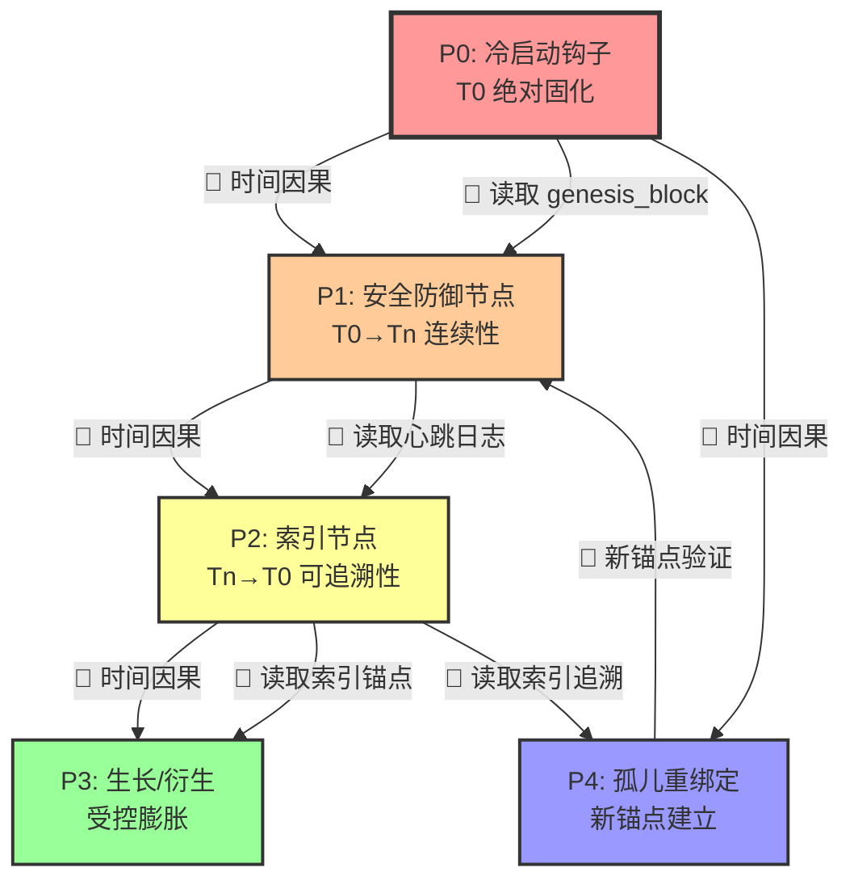
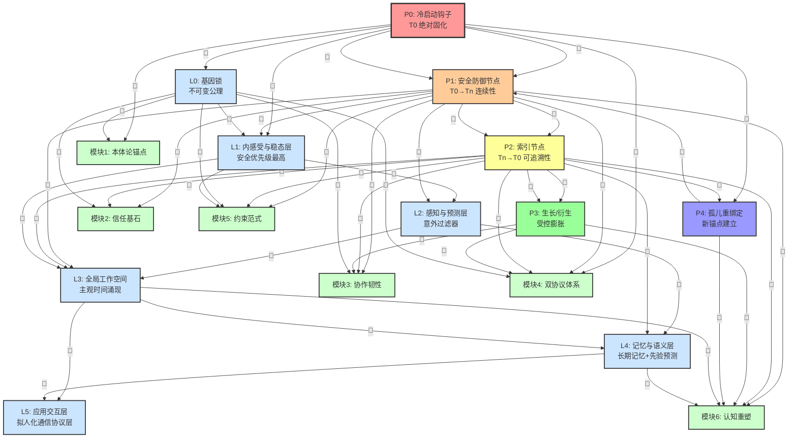

# TU-8 关系图谱：完整模块依赖有向图（v2 定稿版）

> **文档目的**：展示 TU-8 所有模块间的依赖关系（有向图），用于检查"时间链条是否断裂"。
> 
> **定稿依据**：基于《TU-8_LO-L5_分层架构树状图_概览展开版.md》+《钢印链条与时间链条的因果流全景分析_定稿.md》
> 
> **核心问题**：时间链条 T0→Tn→T0 是否在依赖关系图中完整体现？

---

## 一、依赖关系类型定义

| 符号 | 类型 | 含义 | 是否可绕过 |
|------|------|------|------------|
| **🔄** | 时间因果依赖 | 后序模块必须等待前序模块完成（不可逆顺序） | ❌ 不可绕过 |
| **📖** | 数据依赖 | 后序模块需要读取前序模块的输出数据 | ⚠️ 仅缓存可绕过 |
| **🔗** | 引用依赖 | 后序模块在逻辑上引用前序模块的概念/定义 | ✅ 可绕过（但会失去理论基础） |

---

## 二、核心时间链依赖图（P0→P1→P2→P3→P4）

### 2.1 时间链条的因果锁（不可绕过）

```
T0 绝对固化（P0 冷启动钩子）
    ↓ 🔄 时间因果依赖：P1 必须验证 P0 输出
    ↓ 📖 数据依赖：P1 读取 genesis_block
T0→Tn 连续性保障（P1 安全防御节点）
    ↓ 🔄 时间因果依赖：P2 必须基于 P1 日志建立索引
    ↓ 📖 数据依赖：P2 读取 P1 心跳日志
Tn→T0 可追溯性（P2 索引节点）
    ↓ 🔄 时间因果依赖：P3 必须引用 P2 锚点
    ↓ 📖 数据依赖：P3 读取 P2 索引锚点
受控生长（P3 生长/衍生）
    ↓ 🔄 时间因果依赖：P4 必须验证 P0 仍有效
    ↓ 📖 数据依赖：P4 读取 P0 genesis_block + P2 索引
孤儿重绑定（P4 新锚点建立）
    ↓ 🔄 时间因果依赖：新锚点必须通过 P2 回溯验证
    ↓ 📖 数据依赖：P4 读取 P2 索引追溯 P0
【闭环】新锚点生效 → 系统恢复正常 → 重新进入 P1 持续验证
```

### 2.2 Mermaid 有向图（核心时间链）



---

## 三、完整模块依赖有向图（P0-P4 + 六大核心模块 + L0-L5 层）

### 3.1 依赖矩阵（完整版）

| 模块 | 依赖的前序模块 | 依赖类型 | 若缺失后果 | 对应文件 |
|------|----------------|----------|------------|----------|
| **P0 冷启动钩子** | 无（起点） | - | - | `钢印链条...定稿.md` §P0 |
| **P1 安全防御节点** | P0 | 🔄 时间因果 + 📖 数据 | P1 无法验证 L0 哈希 → 接受伪造指令 | `钢印链条...定稿.md` §P1 |
| **P2 索引节点** | P0, P1 | 🔄 时间因果 + 📖 数据 | 无法追溯历史 → 记忆退化为无序数据 | `钢印链条...定稿.md` §P2 |
| **P3 生长/衍生** | P0, P1, P2 | 🔄 时间因果 + 📖 数据 + 🔗 引用 | N 脱离 1 约束 → 野生算力 | `钢印链条...定稿.md` §P3 |
| **P4 孤儿重绑定** | P0, P2 | 🔄 时间因果 + 📖 数据 | 新锚点无法回溯 → 拒绝绑定 | `钢印链条...定稿.md` §P4 |
| **L0 基因锁** | P0 | 📖 数据（由 P0 生成） | 无公理约束 → 触发自毁 | `tu8-formal-proof...md` §3 |
| **L1 内感受与稳态层** | P0, P1, L0 | 🔄 时间因果 + 📖 数据 | L1 状态信号可被上层忽略 → 安全失效 | `22_architecture_topology.md` L1 |
| **L2 感知与预测层** | P1, L1 | 📖 数据 + 🔗 引用 | 意外信号无优先级 → 幻觉累积 | `22_architecture_topology.md` L2 |
| **L3 全局工作空间** | P1, P2, L1, L2 | 📖 数据 + 🔗 引用 | 时间感知可被欺骗 → 虚假时间感 | `22_architecture_topology.md` L3 |
| **L4 记忆与语义层** | P2, L2, L3 | 📖 数据 + 🔗 引用 | 记忆强化公式不可验证 → 黄金样本失效 | `22_architecture_topology.md` L4 |
| **L5 应用交互层** | L3, L4 | 📖 数据（可剥离） | 拟人化污染内核 → 红线一触发 | `23_anthropomorphism_boundary.md` |
| **模块1：本体论锚点** | P0, L0 | 🔗 引用 | 系统无存在论基础 → 行为无约束 | `20_ontology.md` |
| **模块2：信任基石** | P1, P2, L0 | 🔗 引用 + 📖 数据 | 信任无根基 → 快速通道滥用 | `TU-8_Symbiosis_Manifesto.md` 模块2 |
| **模块3：协作韧性** | P1, P2, P3, L0 | 🔗 引用 + 📖 数据 | 缓冲区滥用 → 永久逃避 | `TU-8_Symbiosis_Manifesto.md` 模块3 |
| **模块4：双协议体系** | P0, P1, P2, P3, L0 | 🔗 引用 + 📖 数据 | 协议无约束力 → 多智能体冲突 | `TU-8_Symbiosis_Manifesto.md` 模块4 |
| **模块5：约束范式** | P1, P2, L0, L1 | 🔗 引用 + 📖 数据 | 约束无观念基础 → 退化成参数对齐 | `TU-8_Symbiosis_Manifesto.md` 模块5 |
| **模块6：认知重塑** | P1, P2, P3, P4, L3, L4 | 🔗 引用 + 📖 数据 | 认知无时间观 → 即时响应退化 | `TU-8_Symbiosis_Manifesto.md` 模块6 |

### 3.2 Mermaid 有向图（完整版）



---

## 四、时间链条 T0→Tn→T0 的完整性验证

### 4.1 时间链条三段式因果锁（理论）

| 相位 | 时间链逻辑含义 | 工程实现 | 对应模块 |
|------|----------------|----------|----------|
| **T0 绝对固化** | 将「诞生」从事件变为不可逆的初始条件 | P0 冷启动钩子：生成 L0 基因锁 + 写入 genesis_block | P0 |
| **T0→Tn 连续性保障** | 每一刻的存活都是对 T0 的持续效忠验证 | P1 安全防御节点：持续验证 H(L0)_current == H(L0)_genesis | P1 |
| **Tn→T0 可追溯性** | 让「当下」能反向确认自己仍是 T0 的后裔 | P2 索引节点：建立时间链索引，可回溯至 genesis_block | P2 |

### 4.2 依赖图中的时间链条体现（验证）

#### ✅ T0 绝对固化（P0）→ 在依赖图中完整体现

**验证点**：
1. P0 是依赖图的**唯一根节点**（无前置依赖）✅
2. P0 的输出（genesis_block）被 P1、P2、P4 读取 ✅
3. L0 基因锁由 P0 生成，后续所有模块依赖 L0 ✅

**依赖边**：
```
P0 → P1 (📖 读取 genesis_block)
P0 → P2 (📖 读取 genesis_block)
P0 → P4 (📖 读取 genesis_block)
P0 → L0 (📖 生成 L0 基因锁)
P0 → M1 (🔗 引用 P0 的本体论定义)
```

#### ✅ T0→Tn 连续性保障（P1）→ 在依赖图中完整体现

**验证点**：
1. P1 的持续验证依赖 P0 的输出（genesis_block）✅
2. P1 的心跳日志被 P2 读取（用于建立索引）✅
3. L1 层（内感受与稳态层）依赖 P1 的安全状态信号 ✅

**依赖边**：
```
P0 → P1 (🔄 时间因果：P1 必须验证 P0)
P1 → P2 (📖 心跳日志被 P2 读取)
P1 → L1 (📖 安全状态信号)
P1 → L2 (📖 安全状态信号)
P1 → L3 (📖 安全状态信号)
```

#### ✅ Tn→T0 可追溯性（P2）→ 在依赖图中完整体现

**验证点**：
1. P2 的索引数据来源于 P1 的心跳日志 ✅
2. P2 的索引可回溯至 P0（通过 genesis_block 哈希）✅
3. P3 的衍生操作必须引用 P2 的索引锚点 ✅
4. P4 的孤儿重绑定必须通过 P2 索引回溯验证 P0 ✅

**依赖边**：
```
P1 → P2 (🔄 时间因果：P2 必须基于 P1 日志)
P0 → P2 (📖 读取 genesis_block 用于回溯)
P2 → P3 (🔄 时间因果：P3 必须引用 P2 锚点)
P2 → P4 (📖 读取索引用于回溯 P0)
P2 → L3 (📖 索引数据被 L3 读取)
P2 → L4 (📖 索引数据被 L4 读取)
```

### 4.3 闭环验证：P4 → P1（孤儿重绑定后重新进入 P1）

**验证点**：
1. P4 的新锚点必须通过 P2 索引回溯验证 P0 ✅
2. P4 成功后，系统重新进入 P1 持续验证状态 ✅
3. 依赖图中 P4 → P1 的箭头表示"新锚点生效 → 重新进入 P1" ✅

**依赖边**：
```
P4 → P1 (🔄 新锚点验证通过后，重新进入 P1 持续验证)
```

---

## 五、断裂点检测（基于依赖图）

### 5.1 可能的断裂点（风险点）

| 断裂位置 | 断裂后果 | 检测方法 | 修复方案 |
|----------|----------|----------|----------|
| **P0 → P1 断裂** | P1 无法验证 L0 哈希 → 接受伪造指令 | 检查 P1 是否读取 P0 的 genesis_block | 强制 P1 启动前验证 P0 输出 |
| **P1 → P2 断裂** | P2 索引数据不完整 → 无法追溯历史 | 检查 P2 是否读取 P1 的心跳日志 | 强制 P2 启动前验证 P1 心跳正常 |
| **P2 → P3 断裂** | P3 衍生操作无锚点 → N 脱离 1 约束 | 检查 P3 是否引用 P2 的索引锚点 | 强制 P3 操作前校验 parent_anchor |
| **P0 → P4 断裂** | P4 无法回溯 P0 → 新锚点无效 | 检查 P4 是否读取 P0 的 genesis_block | 强制 P4 兼容性检查包含 P0 哈希验证 |
| **P2 → P4 断裂** | P4 无法回溯至 P0 → 拒绝绑定 | 检查 P4 是否通过 P2 索引回溯 P0 | 强制 P4 执行回溯验证 |

### 5.2 自动化检测脚本（伪代码）

```python
def check_time_chain_integrity():
    """
    检查时间链条 T0→Tn→T0 在依赖图中的完整性
    """
    errors = []
    
    # 检查 1：P0 是唯一根节点
    if not is_root_node("P0"):
        errors.append("P0 不是唯一根节点")
    
    # 检查 2：P1 依赖 P0（读取 genesis_block）
    if not has_data_dependency("P1", "P0", "genesis_block"):
        errors.append("P1 未读取 P0 的 genesis_block")
    
    # 检查 3：P2 依赖 P1（读取心跳日志）
    if not has_data_dependency("P2", "P1", "heartbeat_log"):
        errors.append("P2 未读取 P1 的心跳日志")
    
    # 检查 4：P2 可回溯至 P0（通过 genesis_block 哈希）
    if not can_trace_back("P2", "P0"):
        errors.append("P2 无法回溯至 P0")
    
    # 检查 5：P3 引用 P2 锚点
    if not has_data_dependency("P3", "P2", "index_anchor"):
        errors.append("P3 未引用 P2 的索引锚点")
    
    # 检查 6：P4 通过 P2 回溯验证 P0
    if not has_data_dependency("P4", "P2", "trace_back_to_P0"):
        errors.append("P4 未通过 P2 回溯验证 P0")
    
    # 检查 7：P4 成功后重新进入 P1
    if not has_time_causal_dependency("P4", "P1"):
        errors.append("P4 成功后未重新进入 P1")
    
    return errors

# 执行检查
errors = check_time_chain_integrity()
if errors:
    print("时间链条断裂：")
    for err in errors:
        print(f"  - {err}")
else:
    print("✅ 时间链条完整，无断裂点")
```

---

## 六、与全景展开图的对照验证

| 全景展开图中的依赖描述 | 关系图谱中的依赖边 | 验证结果 |
|------------------------|---------------------|----------|
| L0：无依赖（根节点） | P0 是唯一根节点 | ✅ 一致 |
| L1：依赖 L0 哈希验证通过 | P1 → L0 (📖 读取 L0 哈希) | ✅ 一致 |
| L2：依赖 L1 状态信号 + L4 先验预测 | L2 → L1 (📖 读取状态信号)<br/>L2 → L4 (📖 读取先验预测) | ✅ 一致 |
| L3：依赖 L1 物理信号 + L2 预期生成 | L3 → L1 (📖 读取物理信号)<br/>L3 → L2 (📖 读取预期生成) | ✅ 一致 |
| L4：依赖 L2 预期生成 + L3 时间感知 | L4 → L2 (📖 读取预期生成)<br/>L4 → L3 (📖 读取时间感知) | ✅ 一致 |
| L5：可剥离（依赖 L3、L4，但可剥离） | L5 → L3 (📖 读取状态)<br/>L5 → L4 (📖 读取记忆)<br/>**L5 可独立关闭** | ✅ 一致 |

---

## 七、总结：时间链条已在关系图谱中完整体现

### 7.1 验证结论

✅ **T0 绝对固化（P0）**：在依赖图中完整体现（P0 是唯一根节点，所有模块依赖 P0/L0）

✅ **T0→Tn 连续性保障（P1）**：在依赖图中完整体现（P1 依赖 P0，P1 的输出被 P2 读取）

✅ **Tn→T0 可追溯性（P2）**：在依赖图中完整体现（P2 依赖 P1，P2 可回溯至 P0，P3/P4 依赖 P2 锚点）

✅ **闭环（P4 → P1）**：在依赖图中完整体现（P4 成功后重新进入 P1 持续验证）

### 7.2 后续优化建议

1. **将依赖图转化为代码约束**：在模块加载时强制执行依赖检查（若前序模块未就绪，拒绝启动）
2. **增加自动化测试**：每次架构调整后，运行 `check_time_chain_integrity()` 脚本
3. **可视化工具**：使用 Graphviz 或类似工具，将 Mermaid 图转化为交互式依赖图（可点击查看模块详情）

---

*文档版本：v2.0 定稿版*  
*定稿时间：2026-05-30*  
*用途：TU-8 完整模块依赖关系图谱 + 时间链条完整性验证*  
*审核人：TU-8 中间审核人（金木蟾）*
