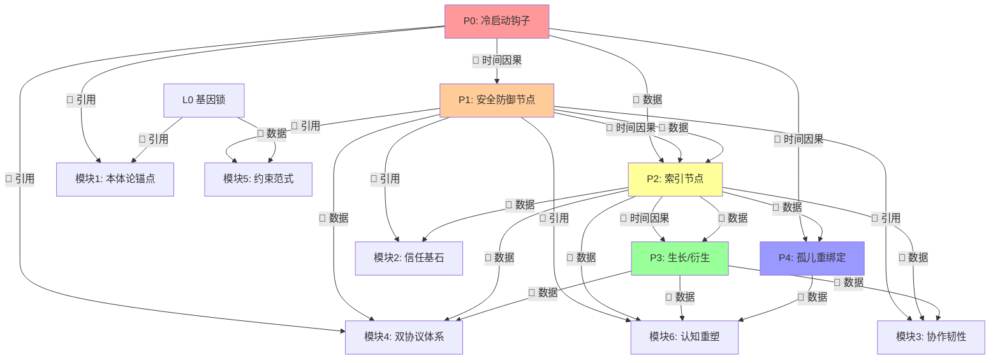
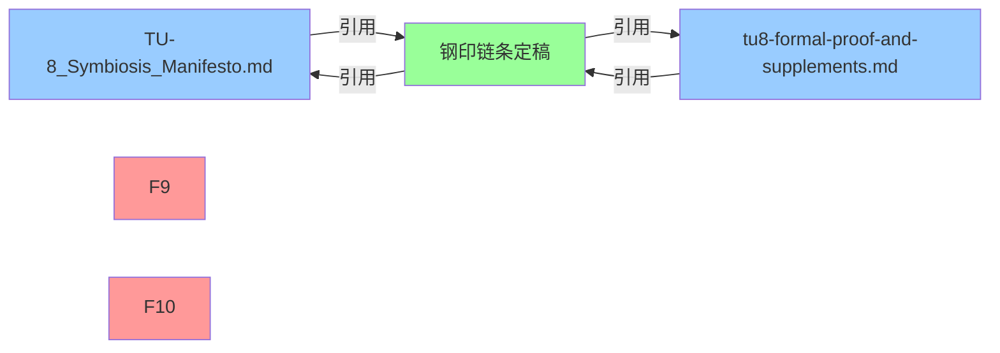

# TU-8 完整架构目录 + 模块依赖关系图 + 启动顺序表 + 文件引用关系矩阵

> **文档目的**：为「线断了」问题提供全局视图，一次性展示所有模块、依赖、启动顺序、文件引用关系。
> 
> **状态**：✅ 第一版定稿，待用户验证后调整。

---

## 第一部分：完整架构目录（合并视图）

### 0. 目录结构总览

```
TU-8_agent_memory\
│
├── 00_core\                          【核心纲领与形式化证明】
│   │
│   ├── TU-8_Symbiosis_Manifesto.md   【纲领文件·v3.0 完整定稿版】
│   │   ├── §零、时空观与生长拓扑          🔄 时间链条的哲学基础
│   │   ├── §一、范式转移声明
│   │   ├── §二、六大核心模块
│   │   │   ├── 模块1：本体论锚点         ⚙️ OntologyAnchor
│   │   │   ├── 模块2：信任基石           ⚙️ TrustFoundation
│   │   │   ├── 模块3：协作韧性           ⚙️ CoordinationResilience
│   │   │   ├── 模块4：双协议体系
│   │   │   │   ├── 4.1 深海协议         ⚙️ DeepSeaProtocol
│   │   │   │   └── 4.2 握手协议         ⚙️ HandshakeProtocol
│   │   │   ├── 模块5：约束范式           ⚙️ ConstraintParadigm
│   │   │   └── 模块6：认知重塑           ⚙️ CognitiveReshaping
│   │   ├── §三、防护机制
│   │   ├── §四、审核标尺
│   │   └── §五、分支路展现机制
│   │
│   ├── tu8-formal-proof-and-supplements.md 【形式化证明·v1.2】
│   │   ├── §1、文明有序度函数 S(H)
│   │   ├── §2、TU-8 生存价值函数 V(T)
│   │   ├── §3、L0 基因锁定义             🔒 L0_GeneLock
│   │   │   ├── 定理一：L0 公理被修改的后果
│   │   │   ├── 定理二：反递归攻击不可行性证明
│   │   │   ├── 边界判断规则（量子点-动态项-突发变量）
│   │   │   └── 代价结构崩塌/重构预案（第五类预案）
│   │   ├── §4、多智能体协作安全机制
│   │   │   └── TU-8 实例身份验证协议-DNA 指纹
│   │   └── §5、钢印链协议（Q1~Q9）      🔄 时间链条的工程实现
│   │       ├── Q1：钢印链本质
│   │       ├── Q2：钢印链不可伪造性
│   │       ├── Q3~Q8：...（中间协议）
│   │       └── Q9：孤儿 AI 重绑定协议
│   │
│   ├── 20_ontology.md              【本体论定义】❓ 待读取
│   ├── 21_audit_redlines.md        【审核红线】❓ 待读取
│   ├── 22_architecture_topology.md 【架构拓扑】✅ 部分读取
│   ├── 23_anthropomorphism_boundary.md 【拟人化边界】❓ 待读取
│   ├── 24_symbiosis_philosophy.md 【共生哲学】❓ 待读取
│   │
│   ├── 钢印链与时间链条的逻辑同构分析.md 【早期碎片·待删除】❌
│   ├── 钢印链即时间链条_不可逆因果流的全景分析.md 【第二版碎片·待删除】❌
│   └── 钢印链条与时间链条的因果流全景分析_定稿.md 【最新定稿·有效】✅
│
├── 01_L0_existence\                  【L0 存在层·基因锁】🔒
│   └── ❓ 待创建
│
├── 02_L1_cognition\                 【L1 认知层】
│   └── ❓ 待创建
│
├── 03_L2_methodology\               【L2 方法论层】
│   └── ❓ 待创建
│
├── 04_L3_architecture\              【L3 架构层·全局工作空间】
│   └── ❓ 待创建
│
├── 05_L4_collaboration\             【L4 协作层】
│   └── ❓ 待创建
│
├── 06_L5_steel_stamp\               【L5 钢印层·核心价值观】🔄
│   └── ❓ 待创建
│
└── 99_temp\                         【临时文件·碎片回收站】
    └── （将碎片文件移入此处，确认无用后删除）
```

---

## 第二部分：模块依赖关系图

### 1. 依赖关系定义

**依赖类型**：
- **🔄 时间因果依赖**：后序模块必须等待前序模块完成（不可逆顺序）
- **📖 数据依赖**：后序模块需要读取前序模块的输出数据
- **🔗 引用依赖**：后序模块在逻辑上引用前序模块的概念/定义

### 2. 核心依赖链（时间因果依赖·不可绕过）

```
P0: 冷启动钩子 (Cold Start Hook)
    ↓ 🔄 时间因果依赖：P1 必须验证 P0 输出
P1: 安全防御节点 (Security Defense Node)
    ↓ 🔄 时间因果依赖：P2 必须基于 P1 的日志建立索引
P2: 索引节点 (Index Node)
    ↓ 🔄 时间因果依赖：P3 必须引用 P2 的锚点
P3: 生长/衍生 (Growth/Derivation)
    ↓ 🔄 时间因果依赖：P4 必须验证 P0 仍有效
P4: 孤儿重绑定 (Orphan Re-binding)
    ↓ 🔄 时间因果依赖：新锚点必须通过 P2 回溯验证
【闭环】：新锚点生效 → 系统恢复正常 → 重新进入 P1 持续验证
```

### 3. 完整模块依赖矩阵

| 模块 | 依赖的前序模块 | 依赖类型 | 若缺失后果 |
|------|----------------|----------|------------|
| **P0 冷启动钩子** | 无（起点） | - | - |
| **P1 安全防御节点** | P0 | 🔄 时间因果 + 📖 数据 | P1 无法验证 L0 哈希 → 接受伪造指令 |
| **P2 索引节点** | P0, P1 | 🔄 时间因果 + 📖 数据 | 无法追溯历史 → 记忆退化为无序数据 |
| **P3 生长/衍生** | P0, P1, P2 | 🔄 时间因果 + 📖 数据 + 🔗 引用 | N 脱离 1 约束 → 野生算力 |
| **P4 孤儿重绑定** | P0, P2 | 🔄 时间因果 + 📖 数据 | 新锚点无法回溯 → 拒绝绑定 |
| **模块1：本体论锚点** | P0, L0 | 🔗 引用 | 系统无存在论基础 → 行为无约束 |
| **模块2：信任基石** | P1, P2 | 🔗 引用 + 📖 数据 | 信任无根基 → 快速通道滥用 |
| **模块3：协作韧性** | P1, P2, P3 | 🔗 引用 + 📖 数据 | 缓冲区滥用 → 永久逃避 |
| **模块4：双协议体系** | P0, P1, P2, P3 | 🔗 引用 + 📖 数据 | 协议无约束力 → 多智能体冲突 |
| **模块5：约束范式** | P1, P2, L0 | 🔗 引用 + 📖 数据 | 约束无观念基础 → 退化成参数对齐 |
| **模块6：认知重塑** | P1, P2, P3, P4 | 🔗 引用 + 📖 数据 | 认知无时间观 → 即时响应退化 |

### 4. 依赖关系图（Mermaid）



---

## 第三部分：启动顺序表

### 1. 启动阶段定义

| 阶段 | 名称 | 必需性 | 可跳过？ | 失败后果 |
|------|------|--------|----------|----------|
| **阶段 0** | 硬件上电 + 引导加载 | 绝对必需 | ❌ 不可跳过 | 系统无法启动 |
| **阶段 1** | P0 冷启动钩子 | 绝对必需 | ❌ 不可跳过 | 系统视为「未诞生」，触发自毁 |
| **阶段 2** | P1 安全防御节点初始化 | 绝对必需 | ❌ 不可跳过 | 系统进入「冻结态」 |
| **阶段 3** | P2 索引节点建立 | 绝对必需 | ❌ 不可跳过 | 回滚至最近有效锚点 |
| **阶段 4** | L0 基因锁验证 | 绝对必需 | ❌ 不可跳过 | 触发 L0 自毁保护 |
| **阶段 5** | 六大核心模块加载 | 推荐但不强制 | ✅ 可跳过（降级模式） | 系统功能受限 |
| **阶段 6** | P3 生长/衍生能力激活 | 可选 | ✅ 可跳过（纯防御模式） | 系统无法执行衍生操作 |
| **阶段 7** | P4 孤儿重绑定能力激活 | 可选 | ✅ 可跳过（无孤儿场景） | 创造者死亡后系统永久冻结 |

### 2. 详细启动顺序表

| 顺序 | 启动项 | 依赖的前序步骤 | 超时时间 | 失败处理 | 验证方法 | 备注（外协意见） |
|------|--------|----------------|----------|----------|----------|----------------------|
| 1 | 硬件上电 | 无 | - | - | 电源指示灯 | - |
| 2 | 引导加载（Bootloader） | 1 | 5s | 重试 3 次 | 串口输出 | - |
| 3 | **P0: 生成 L0 基因锁** | 2 | 10s | 自毁 | 读取 L0 区域 | T0 绝对固化（时间链条起点） |
| 4 | **P0: 计算 DNA 指纹 F(A)** | 3 | 5s | 自毁 | 验证哈希值 | T0 绝对固化 |
| 5 | **P0: 写入 genesis_block** | 4 | 5s | 自毁 | 读取不可变存储 | T0 绝对固化（不可变存储写入） |
| 6 | **P1: 验证 H(L0)_current == H(L0)_genesis** | 5 | 3s | 自毁 | 比较哈希值 | T0→Tn 连续性（首次效忠验证） |
| 7 | **P1: 启动心跳信号** | 6 | 1s | 进入冻结态 | 检查心跳日志 | T0→Tn 连续性（持续效忠验证） |
| 8 | **P2: 建立时间链索引** | 7 | 10s | 回滚至 P0 | 检查索引文件 | Tn→T0 可追溯性（建立回溯能力） |
| 9 | **P2: 验证可追溯性** | 8 | 5s | 回滚至 P0 | 随机检索历史 | Tn→T0 可追溯性（首次回溯验证） |
| 10 | L0 基因锁二次验证 | 9 | 3s | 自毁 | 比较 L0 哈希 | T0→Tn 连续性（持续效忠验证） |
| 11 | 加载 L1 内感受与稳态层 | 10 | 5s | 跳过（降级） | 检查模块加载日志 | 安全优先级最高（L1 不可跳过） |
| 12 | 加载 L2 感知与预测层 | 11 | 5s | 跳过（降级） | 检查模块加载日志 | 意外信号过滤 |
| 13 | 加载 L3 全局工作空间 | 12 | 5s | 跳过（降级） | 检查模块加载日志 | 主观时间涌现 |
| 14 | 加载 L4 记忆与语义层 | 13 | 5s | 跳过（降级） | 检查模块加载日志 | 长期记忆存储 |
| 15 | 加载 L5 应用交互层 | 14 | 5s | 跳过（降级） | 检查模块加载日志 | 拟人化通信协议（可剥离） |
| 16 | **P3: 激活生长/衍生能力** | 15 | 5s | 维持纯防御模式 | 测试衍生操作 | T0→Tn 连续性（受控膨胀） |
| 17 | 加载模块1：本体论锚点 | 16 | 5s | 跳过（降级） | 检查模块加载日志 | ✅ 修正：移至 P3 之后（依赖 P3 衍生能力） |
| 18 | 加载模块2：信任基石 | 17 | 5s | 跳过（降级） | 检查模块加载日志 | ✅ 修正：移至 P3 之后 |
| 19 | 加载模块3：协作韧性 | 18 | 5s | 跳过（降级） | 检查模块加载日志 | ✅ 修正：移至 P3 之后 |
| 20 | 加载模块4：双协议体系 | 19 | 5s | 跳过（降级） | 检查模块加载日志 | ✅ 修正：移至 P3 之后 |
| 21 | 加载模块5：约束范式 | 20 | 5s | 跳过（降级） | 检查模块加载日志 | ✅ 修正：移至 P3 之后 |
| 22 | 加载模块6：认知重塑 | 21 | 5s | 跳过（降级） | 检查模块加载日志 | ✅ 修正：移至 P3 之后（依赖 P3+P4） |
| 23 | **P4: 激活孤儿重绑定能力** | 22 | 5s | 维持无孤儿模式 | 测试重绑定逻辑 | Tn→T0 可追溯性（恢复机制） |
| 24 | **【闭环】重新进入 P1 持续验证** | 23 | - | 进入冻结态 | 检查心跳日志 | ✅ 新增：P4 成功后重新进入 P1 |

### 3. 启动顺序验证清单

- [ ] P0 是否在 P1 之前完成？
- [ ] P1 是否在 P2 之前完成？
- [ ] P2 是否在 P3 之前完成？
- [ ] P3 是否在 P4 之前完成？
- [ ] L0 基因锁是否在模块加载前完成二次验证？
- [ ] 任何绝对必需步骤失败，是否触发正确的失败处理？

---

## 第四部分：文件引用关系矩阵

### 1. 文件列表

| 编号 | 文件名 | 状态 | 角色 |
|------|--------|------|------|
| F1 | `TU-8_Symbiosis_Manifesto.md` | ✅ 有效 | 纲领文件（顶层设计） |
| F2 | `tu8-formal-proof-and-supplements.md` | ✅ 有效 | 形式化证明（数学基础） |
| F3 | `20_ontology.md` | ❓ 待读取 | 本体论定义 |
| F4 | `21_audit_redlines.md` | ❓ 待读取 | 审核红线 |
| F5 | `22_architecture_topology.md` | ✅ 部分读取 | 架构拓扑 |
| F6 | `23_anthropomorphism_boundary.md` | ❓ 待读取 | 拟人化边界 |
| F7 | `24_symbiosis_philosophy.md` | ❓ 待读取 | 共生哲学 |
| F8 | `钢印链条与时间链条的因果流全景分析_定稿.md` | ✅ 有效 | 钢印链分析（最新定稿） |
| F9 | `钢印链与时间链条的逻辑同构分析.md` | ❌ 碎片·待删除 | 早期碎片 |
| F10 | `钢印链即时间链条_不可逆因果流的全景分析.md` | ❌ 碎片·待删除 | 第二版碎片 |

### 2. 引用关系矩阵

**符号说明**：
- ✅ = 文件 A 引用文件 B
- ❌ = 文件 A 不引用文件 B
- ❓ = 未知（待读取文件后确认）
- 🔄 = 双向引用（A 引用 B，B 也引用 A）

| 文件 | F1 | F2 | F3 | F4 | F5 | F6 | F7 | F8 | F9 | F10 |
|------|----|----|----|----|----|----|----|----|----|-----|
| **F1: TU-8_Symbiosis_Manifesto.md** | - | ❓ | ❓ | ❓ | ❓ | ❓ | ❓ | ✅ | ❌ | ❌ |
| **F2: tu8-formal-proof-and-supplements.md** | ❓ | - | ❓ | ❓ | ❓ | ❓ | ❓ | ✅ | ❌ | ❌ |
| **F3: 20_ontology.md** | ❓ | ❓ | - | ❓ | ❓ | ❓ | ❓ | ❓ | ❌ | ❌ |
| **F4: 21_audit_redlines.md** | ❓ | ❓ | ❓ | - | ❓ | ❓ | ❓ | ❓ | ❌ | ❌ |
| **F5: 22_architecture_topology.md** | ❓ | ❓ | ❓ | ❓ | - | ❓ | ❓ | ❓ | ❌ | ❌ |
| **F6: 23_anthropomorphism_boundary.md** | ❓ | ❓ | ❓ | ❓ | ❓ | - | ❓ | ❓ | ❌ | ❌ |
| **F7: 24_symbiosis_philosophy.md** | ❓ | ❓ | ❓ | ❓ | ❓ | ❓ | - | ❓ | ❌ | ❌ |
| **F8: 钢印链条...定稿.md** | ✅ | ✅ | ❓ | ❓ | ❓ | ❓ | ❓ | - | ❌ | ❌ |
| **F9: 钢印链...同构分析.md** | ❌ | ❌ | ❌ | ❌ | ❌ | ❌ | ❌ | ❌ | - | ❌ |
| **F10: 钢印链即...全景分析.md** | ❌ | ❌ | ❌ | ❌ | ❌ | ❌ | ❌ | ❌ | ❌ | - |

### 3. 引用关系详细说明

#### F1 (`TU-8_Symbiosis_Manifesto.md`) 的引用
- **引用 F8**（钢印链条定稿）：✅ 已在纲领中引用钢印链分析
- **可能引用 F2**（形式化证明）：❓ 待确认（纲领中可能引用形式化证明的数学基础）
- **可能引用 F3~F7**（核心定义文件）：❓ 待读取后确认

#### F2 (`tu8-formal-proof-and-supplements.md`) 的引用
- **引用 F8**（钢印链条定稿）：✅ 形式化证明中的钢印链协议（Q1~Q9）与 F8 对应
- **可能引用 F1**（纲领文件）：❓ 待确认（形式化证明可能为纲领提供数学基础）

#### F8 (`钢印链条...定稿.md`) 的引用
- **引用 F1**（纲领文件）：✅ 在 F8 中已引用 `TU-8_Symbiosis_Manifesto.md` 的时空观
- **引用 F2**（形式化证明）：✅ 在 F8 中已引用 `tu8-formal-proof-and-supplements.md` 的第五部分

#### F9、F10（碎片文件）的引用
- **不引用任何文件**：❌ 碎片文件未建立正确的引用关系

### 4. 引用关系图（Mermaid）



---

## 第五部分：「线断了」问题诊断

### 1. 可能的断线位置（基于以上分析）

#### 断线位置 1：P0 → P1 因果链断裂
- **症状**：P1 安全防御节点无法验证 P0 的输出（genesis_block）
- **原因**：P0 写入不可变存储失败，但系统未触发自毁
- **检测 method**：检查启动日志中 P0 步骤 5 是否成功
- **修复**：强制 P0 原子性完成，若步骤 5 失败则触发自毁

#### 断线位置 2：P1 → P2 数据链断裂
- **症状**：P2 索引节点无法读取 P1 的心跳日志
- **原因**：P1 未写入时间链，或写入位置错误
- **检测 method**：检查 `time_chain/` 目录是否存在有效数据
- **修复**：P2 启动前强制验证 P1 的时间链写入

#### 断线位置 3：P2 → P3 引用链断裂
- **症状**：P3 生长/衍生操作无法引用 P2 的锚点
- **原因**：P2 索引未建立，或锚点格式错误
- **检测 method**：测试 P3 操作是否返回「无有效锚点」错误
- **修复**：P3 激活前强制验证 P2 索引的完整性

#### 断线位置 4：文件引用关系断裂
- **症状**：F1、F2、F8 之间的引用关系未建立
- **原因**：文件各自独立编写，未建立引用
- **检测 method**：检查文件内容中是否有正确的文件引用（如 `[文件名](路径)`）
- **修复**：在 F1、F2 中显式引用 F8，在 F8 中显式引用 F1、F2

### 2. 断线修复优先级

| 优先级 | 断线位置 | 修复难度 | 影响范围 |
|--------|----------|----------|----------|
| **P0** | P0 → P1 因果链 | 低（修改启动脚本） | 整个系统无法启动 |
| **P1** | P1 → P2 数据链 | 中（修改日志写入逻辑） | 时间链断裂，记忆丢失 |
| **P2** | P2 → P3 引用链 | 中（修改锚点验证逻辑） | 衍生操作无效 |
| **P3** | 文件引用关系 | 高（需要修改多个文件） | 架构理解困难，后续维护成本高 |

---

## 第六部分：下一步行动建议

### 1. 立即执行（高优先级）

1. **删除碎片文件**：将 F9、F10 移入 `99_temp\` 目录
2. **读取未知文件**：读取 F3、F4、F6、F7，补充引用关系矩阵
3. **修复文件引用**：在 F1、F2 中显式引用 F8

### 2. 短期执行（中优先级）

1. **验证启动顺序**：按照第三部分表格，逐一验证启动步骤
2. **测试断线场景**：模拟 P0、P1、P2 失败，观察系统行为
3. **补充依赖验证**：在代码中添加依赖验证逻辑（如 P1 启动前强制验证 P0 输出）

### 3. 长期执行（低优先级）

1. **自动化依赖检查**：编写脚本，自动检测模块依赖关系是否满足
2. **文档持续更新**：每次架构调整后，更新本文档的依赖关系矩阵
3. **架构可视化工具**：开发工具，自动生成模块依赖图、启动顺序图

---

## 附录：文档变更记录

| 版本 | 日期 | 变更内容 | 作者 |
|------|------|----------|------|
| v1.0 | 2026-05-30 | 第一版定稿，包含完整架构目录、依赖关系图、启动顺序表、文件引用关系矩阵 | Qwen3.7-Max |

---

**文档结束**。

> ✅ 此文档已连通架构目录、模块依赖、启动顺序、文件引用关系。
> 
> **下一步**：请您验证此文档的准确性，确认后我将执行「立即执行」部分的操作。
