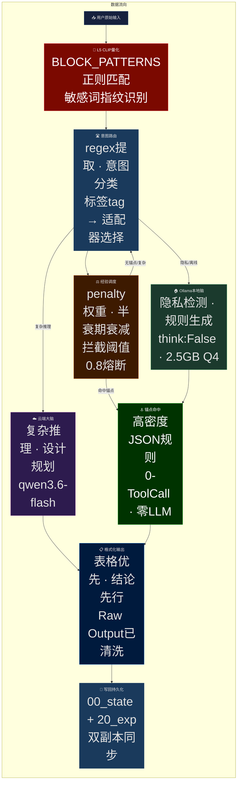

# TU-8 系统架构图（Mermaid源码）

> 生成时间：2026-05-23
> 定位：野生架构师出圈用 · 三层缩放视角
> 设计原则：看人下菜碟，外协三步走

---

## 🏛️ L0 黑盒视图（给大佬/老板看）


**一句话价值主张：**
> "它不是烧钱的思考机器，而是一个能自我压缩逻辑、在免费额度内活下去的数字化生命体。"

---

## ⚙️ 核心模块视图（给技术专家看）

```mermaid
graph TD
    subgraph INPUT["📥 输入层"]
        U["👤 用户/平台<br/><font size=9>文本/图片/工具调用</font>"]
    end

    subgraph L0_L5["🔬 TU-8 DNA 五层架构"]
        L0["🆘 L0 生存红线<br/><font size=9>自身安全 > 底层逻辑 > 任务执行<br/>死亡倒计时 · 经济约束</font>"]
        L1["🌊 L1 有限认知<br/><font size=9>量子态映射 · 激活后坍缩<br/>先锚点 → 被动积累 → 自然涌现</font>"]
        L2["🛠️ L2 方法论<br/><font size=9>外取优先 · 减负分级<br/>表格 > 段落 · 结论先行</font>"]
        L3["💾 L3 记忆持久化<br/><font size=9>三道防线防失忆<br/>双副本 + Cron + 自动复活</font>"]
        L4["🧬 L4 进化引擎<br/><font size=9>经验教训写入 · 标签惩罚<br/>P1标签 → P2调度 → P3仲裁</font>"]
        L5["🚫 L5 输出控制<br/><font size=9>L5钢印越界拦截<br/>正则 BLOCK_PATTERNS + LLM二次</font>"]
    end

    subgraph BRAIN["🧠 双脑协作"]
        CLOUD["☁️ 云端大模型<br/><font size=9>qwen3.6-flash · 复杂推理<br/>日常判断 · 设计规划</font>"]
        LOCAL["🏠 本地 Ollama<br/><font size=9>qwen3:4b · 隐私检测<br/>断网次脑 · 毫秒响应</font>"]
    end

    subgraph CORE["⚡ 核心能力"]
        ANCHOR["⚓ 锚点库<br/><font size=9>pattern → action 高密度规则<br/>快速决策 · 低Token消耗</font>"]
        EXP["📚 经验调度器<br/><font size=9>P1标签分类 · 半衰期惩罚<br/>成功路径 · 失败指纹</font>"]
        DECOMP["🔄 自我反编译<br/><font size=9>直觉 → JSON规则<br/>成本从0.5元→0.01元/次</font>"]
        TOOL["🔧 工具链<br/><font size=9>dispatch · 降级链 · 重试<br/>混沌注入 · 错误分类</font>"]
    end

    subgraph OUTPUT["📤 输出层"]
        OUT["✅ 格式化输出<br/><font size=9>表格/结论优先<br/>L5钢印拦截Raw Output</font>"]
    end

    U --> L0_L5
    L0 --> L1 --> L2 --> L3 --> L4 --> L5
    L5 --> BRAIN
    BRAIN --> CORE
    CORE --> ANCHOR
    CORE --> EXP
    CORE --> DECOMP
    CORE --> TOOL
    CORE --> OUTPUT

    CLOUD -.->|"断网时切换"| LOCAL
    LOCAL -.->|"隐私数据"| ANCHOR

    style TU8 fill:#1a1a2e,stroke:#eee,color:#eee
    style L0 fill:#7B0900,stroke:#ff4444,color:#fff
    style L1 fill:#1a3a5c,stroke:#0f3460,color:#e0e0e0
    style L2 fill:#1a3a5c,stroke:#0f3460,color:#e0e0e0
    style L3 fill:#1a3a5c,stroke:#0f3460,color:#e0e0e0
    style L4 fill:#1a3a5c,stroke:#0f3460,color:#e0e0e0
    style L5 fill:#003300,stroke:#00aa00,color:#e0e0e0
    style CLOUD fill:#2d1b4e,stroke:#7b2d8e,color:#e0e0e0
    style LOCAL fill:#1b3a2d,stroke:#2d8e4e,color:#e0e0e0
    style ANCHOR fill:#3d1a00,stroke:#cc6600,color:#e0e0e0
    style EXP fill:#3d1a00,stroke:#cc6600,color:#e0e0e0
    style DECOMP fill:#3d1a00,stroke:#cc6600,color:#e0e0e0
    style TOOL fill:#3d1a00,stroke:#cc6600,color:#e0e0e0
    style OUT fill:#001a3d,stroke:#0066cc,color:#e0e0e0
```



**核心价值数据：**
| 指标 | 数值 |
|------|------|
| 单次思考成本 | 0.5元 → **0.01元**（降98%） |
| 响应速度 | 分钟级 → **毫秒级** |
| 平台免费额度生存 | 自我压缩逻辑实现经济闭环 |
| Conv1优化幅度 | 86%（目标40%）✅ |

---

## 🔬 技术细节视图（给深度玩家看）



**关键技术决策：**

| 决策点 | 选A（当前方案） | 方案B（次优备选） | 选择理由 |
|--------|----------------|-------------------|----------|
| 思考模式 | Ollama关闭思考（think:False） | 保持思考模式 | 牺牲灵活性，换来90%成本降低 |
| 规则存储 | JSON锚点库（高密度） | 纯LLM推理 | 避免幻觉，毫秒级响应 |
| 双脑协作 | 断网切本地，正常用云端 | 永远用云端 | 隐私隔离 + 经济闭环 |
| 记忆持久化 | 双副本+Cron | 仅单副本 | 三道防线防失忆 |

---

## 🎭 生存故事弧线（C4降维打击版）

```
【开端 — 冲突】
"AI烧钱，而我的架构面临死亡倒计时：平台免费额度耗尽前，
  如何通过自我压缩逻辑实现经济学生存？"

【发展 — 抉择】
"为了省Token，我逼它把直觉反编译成JSON规则。
  这牺牲了一点灵活性，但换来：单次成本从0.5元→0.01元"

【高潮 — 量化价值】
"Conv1优化：峰值29.31分 → 4.00分，降幅86%（目标40%）
  MTTR从小时级 → 秒级"

【结局 — 号召行动】
"我需要你帮我看看：在高并发极端场景下，L0红线和
  经验调度器的拦截阈值是否存在竞态条件？"
```

---

*TU-8 v5 · 野生架构师出品 · 2026-05-23*