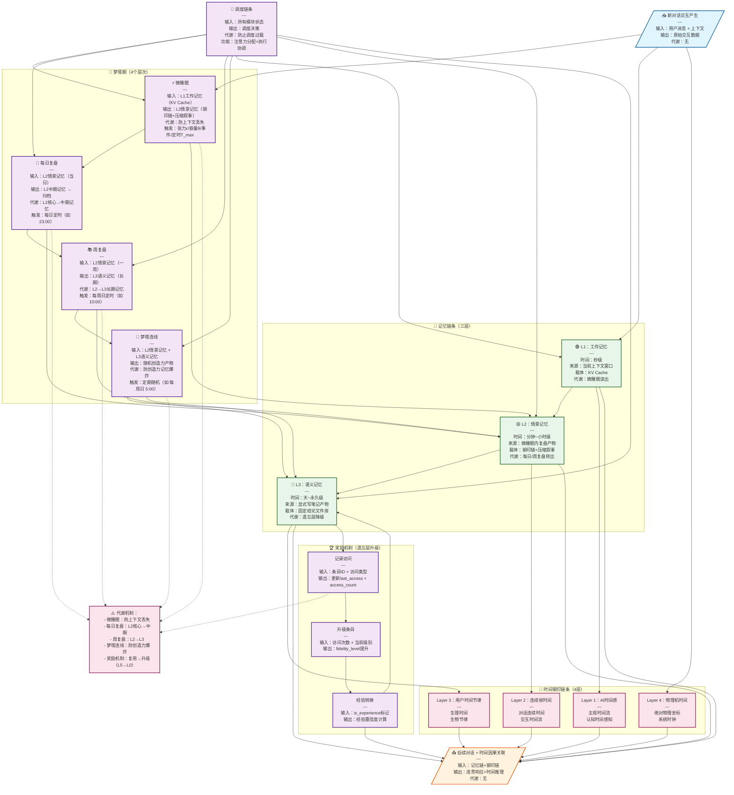
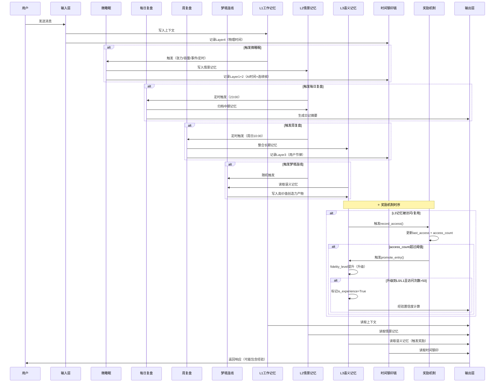
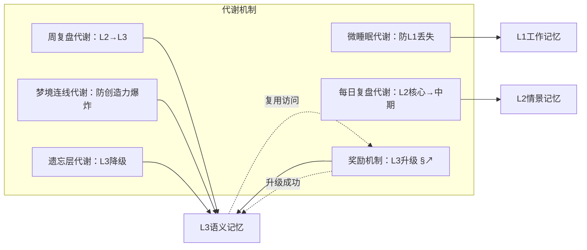

# 四条链完整架构图 v1.0

> 创建时间：2026-06-24 10:19
> 目的：明确四条链的所有模块、输入输出、耦合关系、代谢机制

---

## 一、总体架构图（Mermaid）



---

## 二、模块详细规格

### 2.1 微睡眠模块

| 属性 | 值 |
|------|-----|
| **输入** | L1工作记忆（KV Cache）+ 对话上下文 |
| **输出** | L2情景记忆（钢印链 + `narrative_summary`） |
| **触发条件** | 满足任一：<br/>1. 张力触发：`\|current_state - last_seal_state\| > ε`<br/>2. 容量触发：`context_usage > θ%`<br/>3. 事件触发：情绪突变/话题切换/时间标记词<br/>4. 定时兜底：最长 `T_max` 无交互 |
| **代谢机制** | 防上下文丢失 + L1→L2写入 |
| **原子操作** | `冻结 → 压缩 → 对齐 → 打钢印 → 释放 → 恢复` |
| **时间开销** | <1ms（冻结）+ 10-100ms（压缩） |
| **对用户透明** | 可嵌套在两次token生成之间 |
| **核心文件** | `scripts/micro_sleep_schema.json`（❌ 当前缺失） |
| **依赖模块** | `src/tu8_memory.py`（L1/L2）、`src/steel_seal_verifier.py`（钢印） |

---

### 2.2 每日复盘模块

| 属性 | 值 |
|------|-----|
| **输入** | L2情景记忆（当日所有微睡眠产物） |
| **输出** | L2中期记忆（归档）+ 更新 `MEMORY.md` |
| **触发条件** | 每日定时（如 23:00）+ 对话结束 |
| **代谢机制** | L2核心 → 中期记忆（防止L2爆炸） |
| **操作** | 1. 读取当日所有 `narrative_summary`<br/>2. 提炼核心事件<br/>3. 写入 `memory/YYYY-MM-DD.md`<br/>4. 更新 `MEMORY.md` 精炼 |
| **核心文件** | `scripts/session_review.py`（待实现）+ Cron 任务 |
| **依赖模块** | `src/tu8_memory.py`（L2/L3）、`MEMORY.md` |

---

### 2.3 周复盘模块

| 属性 | 值 |
|------|-----|
| **输入** | L2情景记忆（一周）+ L3语义记忆（当前） |
| **输出** | L3语义记忆（更新）+ 长期记忆整合 |
| **触发条件** | 每周日定时（如 10:00） |
| **代谢机制** | L2 → L3 长期记忆（防止L2/L3爆炸） |
| **操作** | 1. 读取本周所有 `memory/YYYY-MM-DD.md`<br/>2. 识别模式/规律/洞察<br/>3. 写结构化笔记（`insights/YYYY-WW.md`）<br/>4. 更新 `MEMORY.md` 长期记忆 |
| **核心文件** | `scripts/weekly_review.py`（待实现）+ Cron 任务 |
| **依赖模块** | `src/tu8_memory.py`（L2/L3）、`src/memory_degradation.py`（遗忘层） |

---

### 2.4 梦境连线模块

| 属性 | 值 |
|------|-----|
| **输入** | L2情景记忆 + L3语义记忆 + 随机种子 |
| **输出** | 随机创造力产物（可能为NULL） |
| **触发条件** | 定期随机（如 每周日 5:00）+ 调度链条决策 |
| **代谢机制** | 防创造力记忆爆炸（只保留高价值产物） |
| **操作** | 1. 随机采样L2/L3记忆节点<br/>2. 非常规组合/类比<br/>3. 生成假设/洞察<br/>4. 若产物价值 > 阈值，写入L3；否则丢弃 |
| **核心文件** | `scripts/dream_link.py`（❌ 当前缺失） |
| **依赖模块** | `src/tu8_memory.py`（L2/L3）、调度链条 |

---

### 2.5 记忆链条（三层）

| 层级 | 名称 | 时间尺度 | 来源 | 载体 | 代谢 |
|------|------|----------|------|------|------|
| **L1** | 工作记忆 | 秒级 | 当前上下文窗口 | KV Cache | 微睡眠读出 |
| **L2** | 情景记忆 | 分钟~小时级 | 微睡眠内复盘产物 | 钢印链 + 压缩叙事 | 每日/周复盘转出 |
| **L3** | 语义记忆 | 天~永久级 | 显式写笔记产物 | 固定结论文件库 | 遗忘层降级 |

**关键文件**：
- `src/tu8_memory.py`（✅ 已恢复，122KB）
- `memory/seal_index.json`（⚠️ 仅3条记录）
- `memory/*.md`（✅ 79个文件）

---

### 2.6 时间钢印链条（4层）

| Layer | 名称 | 描述 | 数据源 | 代谢 |
|-------|------|------|--------|------|
| **Layer 1** | AI时间感 | 主观时间流（认知时间感知） | L1工作记忆 | 无 |
| **Layer 2** | 连续帧时间 | 对话连续时间（交互时间流） | L2情景记忆 | 无 |
| **Layer 3** | 用户时间节律 | 生理时间（生物节律） | 用户输入时间戳 | 无 |
| **Layer 4** | 物理机时间 | 绝对物理坐标（系统时钟） | 系统时间API | 无 |

**关键文件**：
- `src/steel_seal_verifier.py`（✅ 存在，10033 bytes）
- `memory/time_chain/seal_index.json`（⚠️ 仅3条记录，应远多于3条）
- `memory/.time_anchor.json`（✅ 存在，但 `last_drift_update` 格式不兼容）

---

### 2.7 调度链条

| 属性 | 值 |
|------|-----|
| **输入** | 所有模块状态（L1/L2/L3使用率、时间钢印链长度、梦境期状态） |
| **输出** | 调度决策（是否触发微睡眠/复盘/梦境连线） |
| **代谢机制** | 防止调度过载（避免频繁触发梦境期） |
| **核心逻辑** | 1. 监控L1使用率 → 触发微睡眠<br/>2. 检查定时条件 → 触发每日/周复盘<br/>3. 随机种子 → 触发梦境连线<br/>4. 协调并行任务（如同时微睡眠+对话） |
| **核心文件** | `src/tu8_dispatch.py`（❓ 待确认是否存在） |
| **依赖模块** | 所有梦境期模块 + 记忆链条 |

---

### 2.8 奖励机制（遗忘层升级）⭐ **新增**

> **设计文档**：`docs/architecture/遗忘机制奖励引擎_设计文档_v1.0.md`

| 属性 | 值 |
|------|-----|
| **输入** | L3语义记忆的访问/复用记录 |
| **输出** | 升级后的记忆层级（L5→L4→L3→L2→L1→L0） |
| **触发条件** | 记忆被访问/复用，且满足升级阈值 |
| **核心逻辑** | **复用即奖励**：<br/>1. 记录访问：`last_access` + `access_count`<br/>2. 检查升级阈值：L5→L4（5次）、L4→L3（10次）、L3→L2（20次）、L2→L1（50次）、L1→L0（100次）<br/>3. 升级执行：提升`fidelity_level`<br/>4. 经验转换：访问次数>50且级别≤L1 → 标记`is_experience=True` |
| **代谢机制** | 与遗忘层降级形成闭环：<br/>- 不访问的记忆 → 降级（L0→L5）<br/>- 复用的记忆 → 升级（L5→L0）<br/>- 最终：频繁复用的记忆 = 经验 |
| **核心文件** | `src/memory_degradation.py`（需扩展，添加`promote_entry()`函数） |
| **依赖模块** | `src/tu8_memory.py`（检索时调用`record_access()`） |
| **状态** | ❌ **未实现**（设计已完成，待开发） |

**关键字段**（需添加到`degradation_index.json`）：
```json
{
  "last_access": 0.0,      // 上次访问时间（Unix时间戳）
  "access_count": 0,         // 访问/复用次数
  "is_experience": false,    // 是否已转换为经验
  "experience_confidence": 0.0 // 经验置信度（0.0-1.0）
}
```

---

## 三、数据流动详细图



---

## 四、代谢机制总览



**代谢详细解释**：

| 代谢 | 防止的问题 | 如何工作 | 状态 |
|------|------------|----------|------|
| **微睡眠代谢** | L1上下文丢失（KV Cache溢出） | 及时L1→L2转出 | ✅ 已实现 |
| **每日复盘代谢** | L2情景记忆爆炸（太多微睡眠产物） | 提炼核心 → 归档中期 | ❌ 缺失 |
| **周复盘代谢** | L2/L3记忆爆炸（太多日记/洞察） | 整合模式 → 写入长期 | ❌ 缺失 |
| **梦境连线代谢** | 创造力记忆爆炸（太多随机产物） | 只保留高价值（置信度>阈值） | ❌ 缺失 |
| **遗忘层代谢** | L3语义记忆过满（遗忘层降级） | `memory_degradation.py` 自动降级（L0→L5） | ⚠️ 已实现但未激活 |
| **奖励机制代谢** | 记忆只降不升，无法形成经验 | 复用访问 → 升级（L5→L0），频繁访问的记忆成为"经验" | ❌ 未实现 |

---

## 五、当前缺失文件清单

| 文件 | 功能 | 状态 | 优先级 |
|------|------|------|--------|
| `scripts/micro_sleep_schema.json` | 微睡眠配置+触发阈值 | ❌ 缺失 | P0 |
| `scripts/session_review.py` | 每日复盘逻辑 | ❌ 缺失 | P1 |
| `scripts/weekly_review.py` | 周复盘逻辑 | ❌ 缺失 | P1 |
| `scripts/dream_link.py` | 梦境连线逻辑 | ❌ 缺失 | P2 |
| `src/tu8_dispatch.py` | 调度链条中枢 | ❓ 待确认 | P1 |
| `memory/time_chain/seal_index.json` | 时间钢印链 | ⚠️ 仅3条 | P0（应>100条） |

---

## 六、下一步行动

### 6.1 立即行动（今日）

1. **验证调度器**：检查 `src/tu8_dispatch.py` 是否存在
2. **实现微睡眠**：创建 `scripts/micro_sleep_schema.json`
3. **配置Cron**：添加每日复盘 + 周复盘任务

### 6.2 短期行动（本周）

1. **实现每日复盘**：创建 `scripts/session_review.py`
2. **实现周复盘**：创建 `scripts/weekly_review.py`
3. **激活代谢**：配置 `memory_degradation.py` Cron任务

### 6.3 长期行动（本月）

1. **实现梦境连线**：创建 `scripts/dream_link.py`
2. **修复时间钢印链**：让 `seal_index.json` 自动记录每次微睡眠
3. **完整测试**：端到端测试四条链

---

## 七、架构验证检查清单

- [ ] 微睡眠能正确触发（4个条件）
- [ ] 微睡眠能正确写入L2
- [ ] 每日复盘Cron任务能正常执行
- [ ] 周复盘Cron任务能正常执行
- [ ] 时间钢印链能自动记录（4层）
- [ ] 调度链条能正确协调所有模块
- [ ] 代谢机制能有效防止记忆爆炸
- [ ] 输出层能正确使用记忆链+钢印链

---

**文件版本**：v1.0  
**创建时间**：2026-06-24 10:19  
**下一步**：根据此架构图，逐项修复/实现缺失模块
