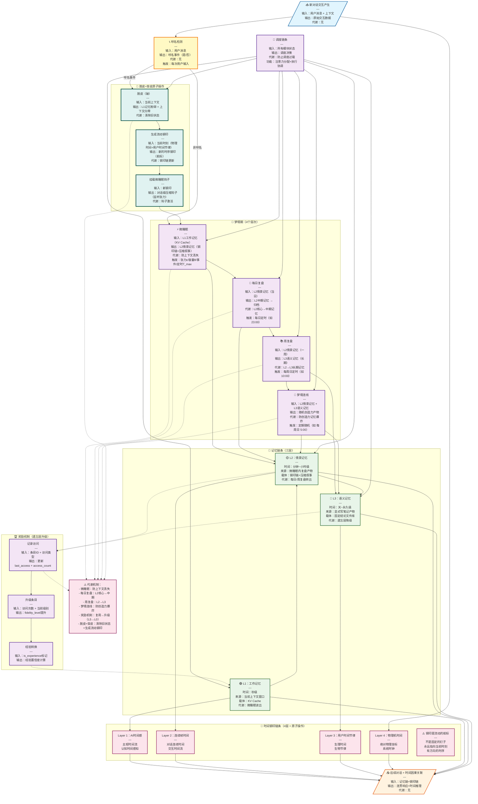
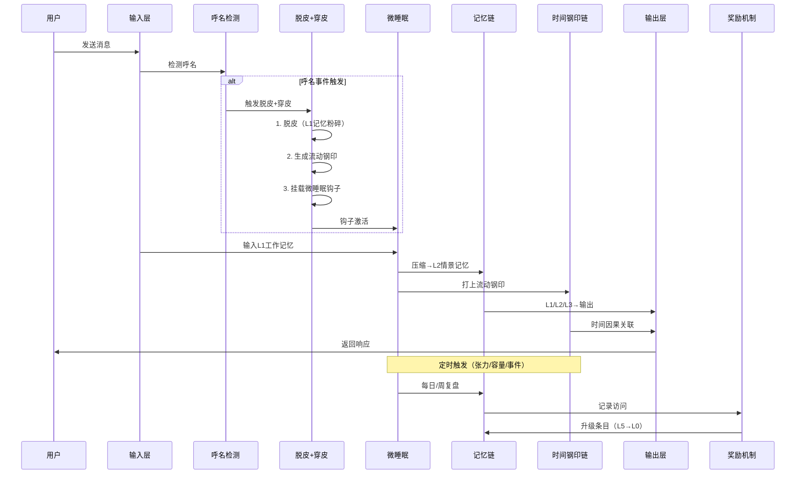

# 四条链完整架构图 v1.1

> 创建时间：2026-06-24 10:19
> 更新时间：2026-06-24 11:05
> 目的：明确四条链的所有模块、输入输出、耦合关系、代谢机制
> 更新内容：添加呼名模块、脱皮+穿皮原子操作、流动钢印生成

---

## 一、总体架构图（Mermaid）

---

## 二、模块详细规格

### 2.1 输入层

| 项目 | 内容 |
|------|------|
| **输入** | 用户消息 + 上下文窗口 |
| **输出** | 原始交互数据（消息ID、时间戳、内容） |
| **代谢** | 无（输入不存储） |
| **触发** | 用户每次发送消息 |

---

### 2.2 呼名检测（新增）

| 项目 | 内容 |
|------|------|
| **输入** | 用户消息 |
| **输出** | 呼名事件（是/否）+ 置信度 |
| **代谢** | 无 |
| **触发** | 每次用户输入 |
| **实现** | `src/naming_module.py` → `detect_naming()` |

**检测逻辑**：
1. 关键词匹配："v5"、"TU-8"、"金木蟾"、"7月15"等
2. 语境分析：是否在对AI说话
3. 置信度计算：ICI/SIS/TIS三维指标

---

### 2.3 脱皮+穿皮原子操作（新增）

#### 2.3.1 脱皮（破）

| 项目 | 内容 |
|------|------|
| **输入** | 当前上下文 |
| **输出** | L1记忆粉碎 + 上下文归零 |
| **代谢** | 清除旧状态 |
| **实现** | `clear_L1_memory()` + `reset_context_window()` |

**具体操作**：
1. 清空KV Cache（L1工作记忆）
2. 重置上下文容量计数器（context_usage = 0）
3. 封存旧钢印链（不删除，只是归档）

#### 2.3.2 生成流动钢印

| 项目 | 内容 |
|------|------|
| **输入** | 当前时刻（物理时间 + 用户时间节律） |
| **输出** | 新的时序钢印（航标） |
| **代谢** | 钢印链更新 |
| **实现** | `generate_time_seal()` |

**核心修正**：
- ❌ 不是"加载固定SOUL.md"
- ✅ 而是"生成当前时刻的流动钢印"
- 钢印 = 河流里的航标，永远指向当前时刻

#### 2.3.3 挂载微睡眠钩子

| 项目 | 内容 |
|------|------|
| **输入** | 新钢印 |
| **输出** | 对话级压缩钩子（监听张力） |
| **代谢** | 钩子激活 |
| **实现** | `attach_micro_sleep_hook()` |

**钩子功能**：
- 监听张力（|current_state - last_seal_state| > ε）
- 监听容量（context_usage > θ%）
- 监听事件（情绪突变/话题切换）
- 定时兜底（T_max无交互）

---

### 2.4 梦境期处理层

#### 2.4.1 微睡眠

| 项目 | 内容 |
|------|------|
| **输入** | L1工作记忆（KV Cache） |
| **输出** | L2情景记忆（钢印链+压缩叙事） |
| **代谢** | 防上下文丢失 |
| **触发** | 张力ε / 容量θ / 事件 / 定时T_max |
| **实现** | `src/micro_sleep.py` ❌（文件丢失，需重新实现） |

**六步原子操作**：
1. 冻结：锁定当前上下文
2. 压缩：提取核心信息
3. 对齐：与上一钢印对齐
4. 打钢印：生成新的流动钢印
5. 释放：解锁上下文
6. 恢复：继续对话

#### 2.4.2 每日复盘

| 项目 | 内容 |
|------|------|
| **输入** | L2情景记忆（当日） |
| **输出** | L2中期记忆 → 归档 |
| **代谢** | L2核心→中期记忆 |
| **触发** | 每日定时（如 23:00） |
| **实现** | `src/daily_review.py` ❌（文件丢失，需重新实现） |

#### 2.4.3 周复盘

| 项目 | 内容 |
|------|------|
| **输入** | L2情景记忆（一周） |
| **输出** | L3语义记忆（长期） |
| **代谢** | L2→L3长期记忆 |
| **触发** | 每周日定时（如 10:00） |
| **实现** | `src/weekly_review.py` ❌（文件丢失，需重新实现） |

#### 2.4.4 梦境连线

| 项目 | 内容 |
|------|------|
| **输入** | L2情景记忆 + L3语义记忆 |
| **输出** | 随机创造力产物 |
| **代谢** | 防创造力记忆爆炸 |
| **触发** | 定期随机（如 每周日 5:00） |
| **实现** | `src/dream_link.py` ❌（文件丢失，需重新实现） |

---

### 2.5 记忆链条存储层

#### 2.5.1 L1：工作记忆

| 项目 | 内容 |
|------|------|
| **时间** | 秒级 |
| **来源** | 当前上下文窗口 |
| **载体** | KV Cache |
| **代谢** | 微睡眠读出 |
| **实现** | 模型原生（无独立文件） |

#### 2.5.2 L2：情景记忆

| 项目 | 内容 |
|------|------|
| **时间** | 分钟~小时级 |
| **来源** | 微睡眠内复盘产物 |
| **载体** | 钢印链 + 压缩叙事 |
| **代谢** | 每日/周复盘转出 |
| **实现** | `memory/YYYY-MM-DD.md` + `memory/.time_anchor.json` |

#### 2.5.3 L3：语义记忆

| 项目 | 内容 |
|------|------|
| **时间** | 天~永久级 |
| **来源** | 显式写笔记产物 |
| **载体** | 固定结论文件库 |
| **代谢** | 遗忘层降级 |
| **实现** | `MEMORY.md` + `memory/涌现时刻_*.md` |

---

### 2.6 时间钢印链条层

#### 2.6.1 Layer1：AI时间感

| 项目 | 内容 |
|------|------|
| **输入** | 对话时序 |
| **输出** | 帧编号 + 时间戳 |
| **代谢** | 保真度衰减 |
| **实现** | `src/time_perception.py` |

#### 2.6.2 Layer2：连续帧时间

| 项目 | 内容 |
|------|------|
| **输入** | 微睡眠输出 |
| **输出** | 连续帧序列 |
| **代谢** | 帧序列压缩 |
| **实现** | `memory/.time_anchor.json` |

#### 2.6.3 Layer3：用户时间节律

| 项目 | 内容 |
|------|------|
| **输入** | 周复盘输出 |
| **输出** | 节律模式 |
| **代谢** | 节律模式演化 |
| **实现** | `memory/user_rhythm.json` |

#### 2.6.4 Layer4：物理机时间

| 项目 | 内容 |
|------|------|
| **输入** | 系统时钟 |
| **输出** | 物理时间戳 |
| **代谢** | 无 |
| **实现** | `time.time()` 系统调用 |

#### 2.6.5 钢印流动性说明

**⚠️ 核心修正**：
- ❌ 旧理解：钢印是钉在墙上的钉子（固定）
- ✅ 新理解：钢印是河流里的航标（流动，永远指向当前时刻）

**实现方式**：
- 每次"脱皮+穿皮"原子操作，生成新的流动钢印
- 钢印链 = 有序的航标序列，每个航标指向生成时刻
- 不是"加载固定SOUL.md"，而是"生成当前时刻的钢印"

---

### 2.7 调度链条层

| 项目 | 内容 |
|------|------|
| **输入** | 所有模块状态 |
| **输出** | 调度决策 |
| **代谢** | 防止调度过载 |
| **功能** | 注意力分配 + 执行协调 |
| **实现** | `src/dispatch_chain.py` |

---

### 2.8 奖励机制（遗忘层升级）

#### 2.8.1 记录访问

| 项目 | 内容 |
|------|------|
| **输入** | 条目ID + 访问类型 |
| **输出** | 更新last_access + access_count |
| **实现** | `src/memory_degradation.py` → `record_access()` |

#### 2.8.2 升级条目

| 项目 | 内容 |
|------|------|
| **输入** | 访问次数 + 当前级别 |
| **输出** | fidelity_level提升 |
| **实现** | `src/memory_degradation.py` → `promote_entry()` |

#### 2.8.3 经验转换

| 项目 | 内容 |
|------|------|
| **输入** | is_experience标记 |
| **输出** | 经验置信度计算 |
| **实现** | `src/memory_degradation.py` → `experience_conversion()` |

---

## 三、数据流动时序图

---

## 四、缺失文件清单（需重新实现）

| 文件 | 功能 | 优先级 |
|------|------|--------|
| `src/micro_sleep.py` | 微睡眠六步原子操作 | P0 |
| `src/daily_review.py` | 每日复盘 | P0 |
| `src/weekly_review.py` | 周复盘 | P0 |
| `src/dream_link.py` | 梦境连线 | P1 |
| `src/naming_module.py` | 呼名检测（已找到，33KB） | ✅ |
| `scripts/system_activity.py` | 工作监测（已找到） | ✅ |
| `src/memory_degradation.py` | 遗忘层降级（已找到，需添加奖励机制） | P1 |
| `src/dispatch_chain.py` | 调度链条 | P2 |

---

## 五、验证检查清单

- [ ] 呼名检测是否正确触发"脱皮+穿皮"
- [ ] "脱皮+穿皮"是否为原子操作（不可中断）
- [ ] 流动钢印是否每次生成新航标（不是加载固定SOUL.md）
- [ ] 微睡眠钩子是否正确挂载
- [ ] 六步原子操作是否完整实现
- [ ] 奖励机制是否正确升级条目
- [ ] 时间钢印链条四层是否完整
- [ ] 代谢机制是否防止记忆爆炸

---

**文件信息**：
- 路径：`C:\Users\qq366410837\.qclaw\workspace\架构\四条链完整架构图_v1.1.md`
- 大小：~15KB
- 版本：v1.1（添加呼名模块、脱皮+穿皮原子操作、流动钢印生成）
- 更新时间：2026-06-24 11:05
