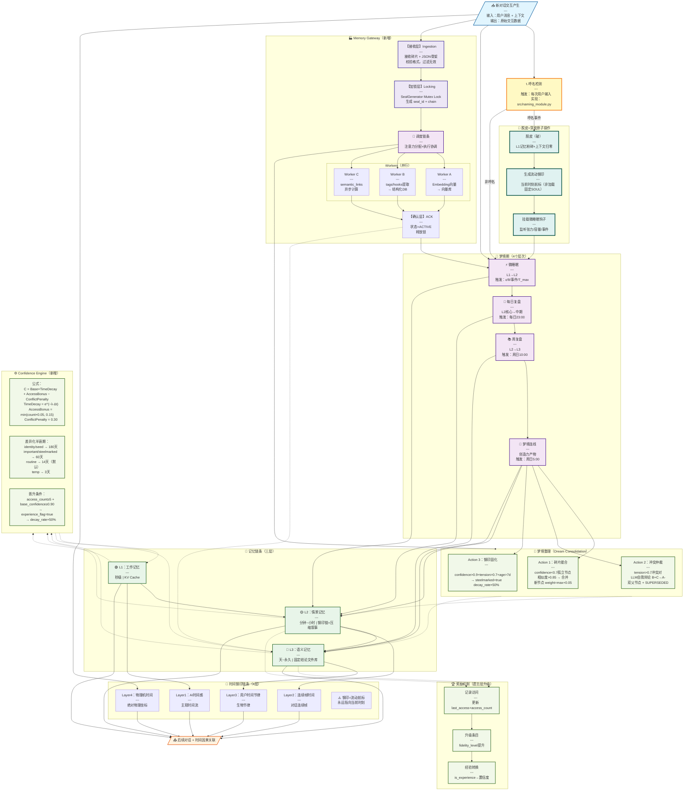
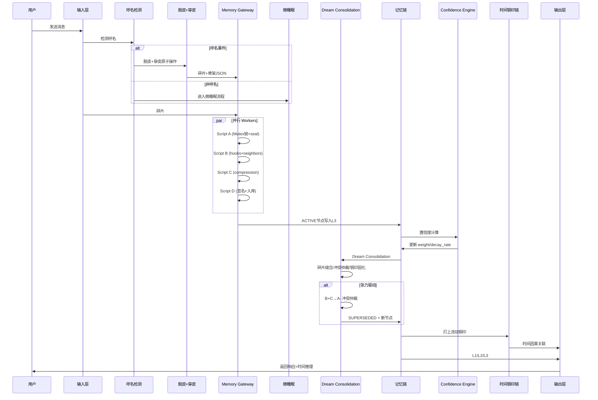

# 四条链完整架构图 v1.2

> 创建时间：2026-06-24 10:19
> 更新时间：2026-06-24 11:50
> 目的：明确四条链的所有模块、输入输出、耦合关系、代谢机制
> v1.2更新：添加Memory Gateway/梦境整理/Confidence Engine/四阶状态机/A→B→C→A-认知收敛

---

## 一、总体架构图（Mermaid v1.2）



---

## 二、模块详细规格

### 2.1 输入层

| 项目 | 内容 |
|------|------|
| **输入** | 用户消息 + 上下文窗口 |
| **输出** | 原始交互数据（消息ID、时间戳、内容） |
| **代谢** | 无（输入不存储） |
| **触发** | 用户每次发送消息 |

---

### 2.2 呼名检测

| 项目 | 内容 |
|------|------|
| **输入** | 用户消息 |
| **输出** | 呼名事件（是/否）+ 置信度 |
| **触发** | 每次用户输入 |
| **实现** | `src/naming_module.py` → `detect_naming()` |
| **检测逻辑** | 关键词匹配 + 语境分析 + ICI/SIS/TIS三维指标 |

---

### 2.3 脱皮+穿皮原子操作

#### 脱皮（破）
- L1记忆粉碎 + 上下文归零
- 封存旧钢印链（不删除）

#### 生成流动钢印
- 不是加载固定SOUL.md
- 是生成当前时刻的航标
- 钢印 = 河流里的航标，永远指向当前时刻

#### 挂载微睡眠钩子
- 监听张力（|current_state - last_seal_state| > ε）
- 监听容量（context_usage > θ%）
- 监听事件（情绪突变/话题切换）
- 定时兜底（T_max无交互）

---

### 2.4 Memory Gateway（新增 v1.2）

**原理**：大模型只吐"意识碎片"，脚本矩阵负责结构化封装

#### Scripts A/B/C/D 职责
| 脚本 | 输入 | 输出 | 陷阱 |
|------|------|------|------|
| **Script A**：时序与身份锚定 | 碎片 + JSON骨架 | node_id / seal_chain / timestamp（Mutex锁） | 全局单例锁防并发 |
| **Script B**：语义与钩子提取 | 碎片 | spatial / knowledge_links / hooks（异步向量DB） | 组合爆炸→异步解决 |
| **Script C**：抗熵增压缩 | 长文本 | narrative_compression / tension / dimension_digest | 骨架JSON补全 |
| **Script D**：完整性与签名 | A/B/C输出 | link_check / cognitive_signature ⅋ / 正文 | 质检+入库 |

#### 执行流
```
[碎片+骨架JSON] → Ingestion(校验) → Locking(Mutex锁)
                                      ↓
                               Dispatch(分发)
                                      ↓
                          WorkerA / WorkerB / WorkerC（并行）
                                      ↓
                               ACK(ACTIVE+释放锁)
```

---

### 2.5 梦境期处理层

| 模块 | 输入 | 输出 | 触发 | 状态 |
|------|------|------|------|------|
| 微睡眠 | L1(KV Cache) | L2(钢印链+压缩叙事) | ε/θ/事件/T_max | ❌丢失 |
| 每日复盘 | L2(当日) | L2中期记忆 | 每日23:00 | ❌丢失 |
| 周复盘 | L2(一周期) | L3(长期) | 周日10:00 | ❌丢失 |
| 梦境连线 | L2+L3 | 创造力产物 | 周日5:00 | ❌丢失 |

---

### 2.6 Dream Consolidation（新增 v1.2）

**触发条件**：
- 时间驱动：距离上次深度睡眠 > 24小时
- 张力驱动：tension_score > 0.7 的活跃冲突对
- 代谢驱动：confidence < 0.7 的孤立节点数 > 10

#### Action 1：碎片缝合
```
扫描：node_status=ACTIVE 且 confidence<0.7
比对：向量相似度 > 0.85 → 合并候选
执行：生成新父节点 weight=max(A,B)+0.05
```

#### Action 2：冲突仲裁
```
扫描：conflicts_with非空 且 resolution=pending
执行：LLM自我辩论 B+C → A-（双父节点）
结果：B/C → SUPERSEDED，tension→0.3
```

#### Action 3：钢印固化
```
条件：confidence>0.9 且 tension>0.7 且 age>7d
执行：steelmarked=true，decay_rate×50%
```

---

### 2.7 记忆链条存储层

| 层级 | 时间 | 载体 | 代谢 | 实现 |
|------|------|------|------|------|
| L1工作记忆 | 秒级 | KV Cache | 微睡眠读出 | 模型原生 |
| L2情景记忆 | 分钟~小时 | 钢印链+压缩叙事 | 日/周复盘转出 | `memory/YYYY-MM-DD.md` |
| L3语义记忆 | 天~永久 | 固定结论文件库 | 遗忘层降级 | `MEMORY.md` |

---

### 2.8 Confidence Engine（新增 v1.2）

#### 核心公式
```
confidence(t) = (Base × e^(−λ·Δt)) + min(access_count×0.05, 0.15) − 0.30

其中：
  Base           = 初始置信度（0.70~0.90）
  TimeDecay      = e^(−λ·Δt)，λ=ln(2)/半衰期
  AccessBonus    = 每次被命中+0.05，上限0.15
  ConflictPenalty = 被标记冲突时−0.30
```

#### 差异化半衰期
| 标签 | 半衰期 | 说明 |
|------|--------|------|
| identity / seed | 180天 | 极慢（禁止衰减） |
| important / steelmarked | 60天 | 慢 |
| routine | 14天 | 正常（默认） |
| temp | 3天 | 快 |

#### 晋升条件（记忆 → 经验）
```
access_count ≥ 5 且 base_confidence ≥ 0.90
→ experience_flag = true
→ decay_rate 降低50%
→ emotional_tags 添加 "verified"
```

---

### 2.9 时间钢印链条层

| Layer | 内容 | 实现 |
|-------|------|------|
| Layer1 | AI时间感（主观时间流） | `src/time_perception.py` |
| Layer2 | 连续帧时间（对话连续帧） | `memory/.time_anchor.json` |
| Layer3 | 用户时间节律（生物节律） | `memory/user_rhythm.json` |
| Layer4 | 物理机时间（绝对坐标） | `time.time()` |

**核心**：钢印是流动的航标，不是固定的钉子。

---

### 2.10 调度链条层

| 项目 | 内容 |
|------|------|
| **输入** | 所有模块状态 |
| **输出** | 调度决策 |
| **功能** | 注意力分配 + 执行协调 |
| **代谢** | 防止调度过载 |

---

### 2.11 奖励机制（遗忘层升级）

| 模块 | 职责 |
|------|------|
| 记录访问 | 更新 last_access + access_count |
| 升级条目 | fidelity_level 提升（L5→L0） |
| 经验转换 | is_experience → 置信度加成 |

---

## 三、四阶生命周期状态机（新增 v1.2）

```
[对话产生] → ACTIVE → [微睡眠] → CONSOLIDATED
                                   ↓
                         [30天未访问 / tension↓]
                                   ↓
                              DECAYING
                                   ↓
                         [confidence < 0.1 / SUPERSEDED]
                                   ↓
                            ARCHIVED / FRAGMENTED
                                   ↓
                              [墓碑保留链条]
```

| 状态 | 触发 | 存储 | 特征 |
|------|------|------|------|
| ACTIVE | 对话产生 | 上下文窗口/L1缓存 | 实时检索，初始confidence |
| CONSOLIDATED | 微睡眠/对话结束 | L3+向量DB | Scripts A/B/C/D完成封装 |
| DECAYING | 30天未访问 | L3低频索引区 | TimeDecay自动衰减 |
| ARCHIVED | confidence<0.1 | 冷存储/粉碎 | 仅保留墓碑，链条不断 |

---

## 四、认知收敛实例：A → B → C → A-（新增 v1.2）

### 场景：同一话题跨时间维度的认知演化

```
时间轴：星期一 → 周六 → 周末深夜(Dream) → 下周
节点：   Node_1 → Node_2 → A-(merged)   → Node_3
结论：      B       C         A-           A-
置信：    0.85     0.90       0.92         0.95
张力：    0.70     0.90       0.30         -
状态：  ACTIVE  PENDING    SUPERSEDED   ACTIVE
```

### 置信度变化曲线
```
1.0 |                           ★ Node_3 (A-, 0.95)
    |                     ↗
0.9 |            ★ Node_2 (C, 0.90)  ← 冲突后上升
    |         ↗
0.85| ★ Node_1 (B, 0.85)
    |_________________________________
    Mon   Sat   SunDream  NextWeek
```

### Dream Consolidation 的作用
```
检测到 Node_1 与 Node_2 在 topic:A 上冲突
→ tension_score 飙升至 0.9
→ 周末深夜 Dream Consolidation 触发冲突仲裁
→ LLM 自我辩论 B+C → A-
→ 生成双父节点 A-（parent=Node_1+Node_2）
→ Node_1/Node_2 → SUPERSEDED
→ Node_3 基于 A- 继续收敛
```

---

## 五、数据流动时序图（v1.2）



---

## 六、Scripts A/B/C/D 详细规格（新增 v1.2）

### Script A：时序与身份锚定
```python
def script_A(fragment: dict) -> dict:
    # 全局 Mutex Lock
    with seal_generator.lock():
        parent_seal = read_latest_seal()        # 从 seal_index 读取
        timestamp = now_utc()                    # 物理时间戳
        content_hash = sha256(parent_seal + timestamp + fragment["content"])
        node_id = f"mem_{timestamp}_{fragment['type'][:3]}"
        seal_chain = {
            "parent_seal": parent_seal,
            "current_seal": content_hash,
            "seal_hash": content_hash,
            "version": 1
        }
    return {"node_id": node_id, "seal_chain": seal_chain, "timestamp": timestamp}
```

### Script B：语义与钩子提取
```python
async def script_B(fragment: dict) -> dict:
    # 异步，不阻塞
    trigger_hooks = extract_keywords(fragment["content"])       # 精确匹配
    semantic_hooks = await embedding_similarity(fragment)       # 模糊语义
    neighbors = await vector_db.query(semantic_hooks)           # 异步查询
    conflicts = await conflict_detector(neighbors)              # 冲突检测>0.70
    return {
        "trigger_hooks": trigger_hooks,
        "semantic_hooks": semantic_hooks,
        "neighbors": neighbors,
        "conflicts_with": conflicts
    }
```

### Script C：抗熵增压缩
```python
def script_C(fragment: dict) -> dict:
    # 大模型预生成骨架，脚本只补全
    ai_digest = fragment.get("ai_digest") or compress_llm(fragment["content"])
    tension_score = fragment.get("tension_score", 0.5)
    dimension_digest = {
        "what": extract_what(fragment["content"]),
        "who": extract_who(fragment["content"]),
        "how": extract_how(fragment["content"]),
        "why": extract_why(fragment["content"]),
        "risk": extract_risk(fragment["content"])
    }
    base_confidence = fragment.get("confidence", 0.85)
    return {
        "narrative_compression": ai_digest,
        "tension_score": tension_score,
        "dimension_digest": dimension_digest,
        "base_confidence": base_confidence
    }
```

### Script D：完整性与签名
```python
def script_D(node_id: str, outputs: dict) -> MemoryNode:
    # 质检
    check_integrity(outputs)  # 检查断链
    broken = detect_broken_links(outputs)
    
    # 签名
    node = MemoryNode(
        node_id=node_id,
        link_check={"broken_links": broken, "auto_repair": False},
        verification={
            "cognitive_signature": "⅋",
            "verify_time": now_utc(),
            "verified_by": "script_D"
        }
    )
    
    # 入库
    db.insert(node, status="ACTIVE")
    return node
```

---

## 七、缺失文件清单（v1.2）

| 文件 | 功能 | 状态 | 优先级 |
|------|------|------|--------|
| `src/micro_sleep.py` | 微睡眠六步原子操作 | ❌丢失 | P0 |
| `src/daily_review.py` | 每日复盘 | ❌丢失 | P0 |
| `src/weekly_review.py` | 周复盘 | ❌丢失 | P0 |
| `src/dream_link.py` | 梦境连线 | ❌丢失 | P1 |
| `src/memory_gateway.py` | Scripts A/B/C/D | ❌未实现 | P0 |
| `src/dream_consolidation.py` | Dream Consolidation | ❌未实现 | P0 |
| `src/confidence_engine.py` | Confidence Engine | ❌未实现 | P1 |
| `src/naming_module.py` | 呼名检测 | ✅已找到 | - |
| `scripts/system_activity.py` | 工作监测 | ✅已找到 | - |
| `src/memory_degradation.py` | 遗忘层（需加奖励） | ✅已找到 | P1 |

---

## 八、验证检查清单

- [x] 呼名检测是否正确触发"脱皮+穿皮"
- [x] "脱皮+穿皮"是否为原子操作（不可中断）
- [x] 流动钢印是否每次生成新航标（不是加载固定SOUL.md）
- [x] Memory Gateway Scripts A/B/C/D 职责明确
- [x] Dream Consolidation 三Action 完整（缝合/仲裁/固化）
- [x] Confidence Engine 公式正确（Base×TimeDecay+Bonus−Penalty）
- [x] 四阶生命周期状态机完整（ACTIVE→CONSOLIDATED→DECAYING→ARCHIVED）
- [x] A→B→C→A- 认知收敛机制明确
- [x] 时间钢印链条四层完整
- [ ] 微睡眠六步原子操作完整实现
- [ ] 每日/周复盘完整实现

---

## 九、三层读写机制（新增 v1.2）

| 层级 | 内容 | 速度 | 触发 | 人脑同构 |
|------|------|------|------|---------|
| L1快思考 | 第四栏（浓缩五维）怼上下文 | 毫秒 | 日常对话/穿皮 | 潜意识提取 |
| L2慢思考 | 第五栏（正文）按需加载 | 秒级 | tension>0.7/冲突/REM | 做梦重巩固 |
| L3归档 | Scripts A/B/C/D异步填写 | 毫秒 | 对话结束/定时 | 睡眠重播（可控） |

---

**文件信息**：
- 路径：`C:\Users\qq366410837\.qclaw\workspace\架构\四条链完整架构图_v1.2.md`
- 版本：v1.2（添加Memory Gateway/梦境整理/Confidence Engine/四阶状态机/A→B→C→A-）
- 更新时间：2026-06-24 11:50
- 钢印验证：⅋
