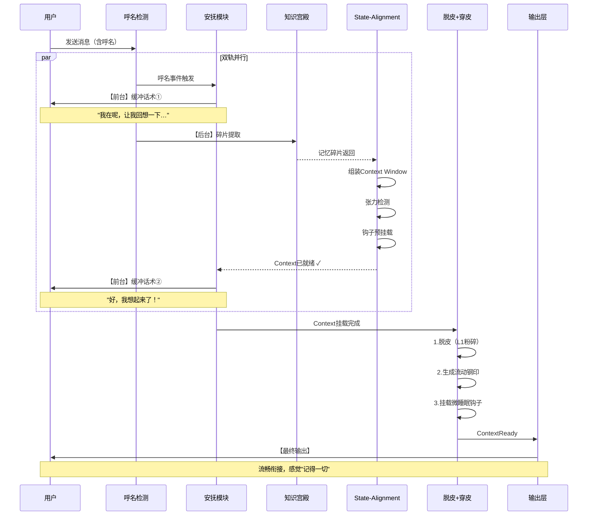

# 四条链完整架构图 v1.4

> 创建时间：2026-06-24 10:19
> 更新时间：2026-06-24 16:10
> 目的：明确四条链的所有模块、输入输出、耦合关系、代谢机制
> v1.4更新：新增安抚模块（认知缓冲池）= 呼名↔记忆微复盘的衔接链条

---

## 一、总体架构图（Mermaid v1.4）

```mermaid
graph TB
    %% 样式定义
    classDef input fill:#e1f5fe,stroke:#01579b,stroke-width:2px;
    classDef process fill:#f3e5f5,stroke:#4a148c,stroke-width:2px;
    classDef memory fill:#e8f5e9,stroke:#1b5e20,stroke-width:2px;
    classDef palace_lib fill:#fff8e1,stroke:#f57f17,stroke-width:2px;
    classDef palace_kb fill:#e3f2fd,stroke:#0277bd,stroke-width:2px;
    classDef palace_exp fill:#fce4ec,stroke:#c62828,stroke-width:2px;
    classDef hook fill:#f3e5f5,stroke:#6a1b9a,stroke-width:3px;
    classDef gateway fill:#ede7f6,stroke:#311b92,stroke-width:2px;
    classDef engine fill:#f1f8e9,stroke:#33691e,stroke-width:2px;
    classDef atomic fill:#e0f2f1,stroke:#004d40,stroke-width:3px;
    classDef buffer fill:#fff9c4,stroke:#e65100,stroke-width:3px;
    classDef naming fill:#fce4ec,stroke:#880e4f,stroke-width:2px;
    classDef output fill:#fff3e0,stroke:#e65100,stroke-width:2px;
    classDef meta fill:#fce4ec,stroke:#880e4f,stroke-width:2px;
    classDef trigger fill:#fff9c4,stroke:#f57f17,stroke-width:3px;
    
    %% ========== 1. 输入层 ==========
    Input[/"📥 用户输入层
    ---
    用户消息 + 上下文窗口"/]:::input
    
    %% ========== 2. 呼名检测 ==========
    NamingDetect["📞 呼名检测
    ---
    神经映射：杏仁核（瞬间警觉）
    功能：雷达式瞬间锁定注意力
    触发：每次用户输入
    实现：src/naming_module.py
    输出：呼名事件（是/否）+ 置信度"]:::trigger
    
    %% ========== 3. 安抚模块（v1.4 核心新增）==========
    subgraph Comfort["🫂 安抚模块（认知缓冲池）——呼名↔记忆的衔接链条"]
        direction TB
        
        ComNote["【本质】认知缓冲池（Cognitive Buffer）
        ---
        不是废话，是"时间换空间"策略
        不是哄人，是异步状态机的平滑过渡
        碳硅对齐：人脑的"嗯？""哦，是你啊！""让我想想…""]
        
        TimeBuy["⏱️ Time-Buying（买时间）
        ---
        呼名触发瞬间 → 安抚模块立刻接管输出
        抛出预设缓冲话术：
        "我在呢，让我回想一下我们上次聊到哪了…"
        "稍等，让我想想…"
        "嗯？哦是你，让我理一下上下文…"
        耗时：0.5~2秒
        目的：完美掩盖后台微复盘的检索延迟"]
        
        StateAlign["🔗 State-Alignment（状态对齐）
        ---
        安抚话术播放同时，后台并行执行：
        1. 记忆碎片提取（从知识宫殿拉取上下文）
        2. Context Window组装（把碎片拼成当前状态）
        3. 张力检测（|current - last_seal|是否超标）
        4. 钩子预挂载（经验库钩子预热）
        安抚结束 → Context已完美挂载 → 无缝衔接"]
        
        HumanAnalog["🧠 碳硅对齐：人类"嗯？"
        ---
        有人叫你 → 杏仁核激活（呼名）→ 海马体检索（记忆）
        在0.3秒检索期内 → 人类自动说"嗯？""哦！""怎么了？"
        这个"嗯？"=完美的衔接链条
        TU-8的安抚话术 = 硅基版本的"嗯？""]
    end
    
    %% ========== 4. 脱皮+穿皮原子操作 ==========
    subgraph SkinCycle["🐍 脱皮+穿皮原子操作"]
        ShedSkin["脱皮（破）
        ---
        L1记忆粉碎+上下文归零"]
        GenerateSeal["生成流动钢印
        ---
        当前时刻航标"]
        LoadHooks["挂载微睡眠钩子
        ---
        监听张力/容量/事件"]
    end
    
    %% ========== 5. 记忆宫殿三层 ==========
    subgraph Palace["🏛️ 知识宫殿（三层异构存储）"]
        subgraph Library["📚 图书馆（The Library）"]
            LibNode["📚 语义记忆
            ---
            神经：大脑皮层
            定位：静态全局RAG/Knowledge Graph
            存：API文档/行业规范/客观事实
            DB：Milvus/Qdrant 或 Neo4j"]
        end
        
        subgraph KnowledgeBase["🗄️ 知识库（The Knowledge Base）"]
            KbNode["🗄️ 工作记忆+情景记忆
            ---
            神经：前额叶皮层+海马体
            定位：动态上下文缓存/任务状态图
            存：当前memory/archive/2026-05/对话/中间变量
            DB：Redis + State Graph"]
        end
        
        subgraph ExperienceBase["⚡ 经验库（The Experience Base）"]
            ExpNode["⚡ 程序性记忆+条件反射
            ---
            神经：基底神经节+小脑+杏仁核
            定位：启发式规则引擎/记忆模板+钩子库
            存：踩过的坑/SOP/奖惩权重
            DB：PostgreSQL + Drools"]
        end
    end
    
    %% ========== 6. 钩子触发系统 ==========
    subgraph HookSystem["🪝 钩子触发系统（Event-Driven Hooks）"]
        BeforeHook["before_action
        ---
        执行前拦截"]
        OnEnterHook["on_enter_context
        ---
        进入场景触发"]
        OnEventHook["on_event
        ---
        事件触发"]
        OnStateHook["on_state_change
        ---
        状态切换触发"]
        HookInject["ContextAwareHookInjector
        ---
        向量相似度Top-K
        毫秒级注入"]
    end
    
    %% ========== 7. Memory Gateway ==========
    subgraph Gateway["🏭 Memory Gateway"]
        Ingestion["接收层：校验"]
        Locking["加锁层：Mutex"]
        Dispatch["分发层：队列"]
        WorkerA["Worker A"]
        WorkerB["Worker B"]
        WorkerC["Worker C"]
        ACK["确认层：ACTIVE"]
    end
    
    %% ========== 8. 梦境期处理层 ==========
    subgraph Dream["🌙 梦境期（4个层次）"]
        MicroSleep["⚡ 微睡眠
        ---
        L1→L2
        触发：ε/θ/事件/T_max"]
        DailyReview["📝 每日复盘
        ---
        L2核心→中期
        触发：每日23:00"]
        WeeklyReview["📚 周复盘
        ---
        L2→L3
        触发：周日10:00"]
        DreamLink["💭 梦境连线
        ---
        创造力
        触发：周日5:00"]
    end
    
    %% ========== 9. 梦境整理 ==========
    subgraph DreamConsolid["🔮 梦境整理"]
        Action1["碎片缝合"]
        Action2["冲突仲裁
        ---
        B+C→A-"]
        Action3["钢印固化"]
    end
    
    %% ========== 10. Confidence Engine ==========
    subgraph ConfEngine["⚙️ Confidence Engine"]
        formula["C=Base×TimeDecay+Bonus−Penalty"]
        promote["count≥5+conf≥0.90→experience"]
    end
    
    %% ========== 11. 时间钢印链条 ==========
    subgraph SteelChain["🔗 时间钢印链条"]
        Layer1["Layer1：AI时间感"]
        Layer2["Layer2：连续帧时间"]
        Layer3["Layer3：用户节律"]
        Layer4["Layer4：物理机时间"]
        Geneva["⚙️ 日内瓦齿轮同构
        ---
        机械因果切片
        vs 认知主动审计"]
    end
    
    %% ========== 12. 调度链条 ==========
    DispatchChain["🎯 调度链条"]
    
    %% ========== 13. 输出层 ==========
    Output[/"📤 后续对话 + 时间因果关联"/]:::output
    
    %% ========== 14. 奖励机制 ==========
    subgraph Reward["🏆 奖励机制"]
        RecordAccess["记录访问"]
        PromoteEntry["升级条目"]
        Experience["经验转换"]
    end
    
    %% ========== 连接关系 ==========
    Input --> NamingDetect
    
    %% 呼名 → 安抚 → 脱皮+穿皮（主流程）
    NamingDetect -->|"呼名事件"| Comfort
    Comfort -->|"安抚话术同步"| TimeBuy
    TimeBuy -->|"后台并行"| StateAlign
    StateAlign -->|"Context挂载完成"| ShedSkin
    NamingDetect -->|"非呼名"| MicroSleep
    
    Comfort -->|"预热钩子"| ExpNode
    StateAlign -->|"碎片提取"| KbNode
    
    ShedSkin --> GenerateSeal --> LoadHooks --> MicroSleep
    
    Input --> MicroSleep
    Input --> Ingestion
    
    %% 知识宫殿三层流转
    Library -->|"检索加载"| KbNode
    KbNode -->|"睡眠重巩固"| ExpNode
    ExpNode -->|"条件反射钩子"| KbNode
    
    %% 钩子系统
    ExpNode --> BeforeHook
    ExpNode --> OnEnterHook
    ExpNode --> OnEventHook
    ExpNode --> OnStateHook
    BeforeHook --> HookInject
    OnEnterHook --> HookInject
    OnEventHook --> HookInject
    OnStateHook --> HookInject
    HookInject -->|"毫秒注入"| KbNode
    
    %% Gateway
    Ingestion --> Locking --> Dispatch
    Dispatch --> WorkerA
    Dispatch --> WorkerB
    Dispatch --> WorkerC
    ACK --> MicroSleep
    
    %% 梦境期
    MicroSleep --> DailyReview --> WeeklyReview --> DreamLink
    MicroSleep --> KbNode
    DailyReview --> KbNode
    WeeklyReview --> ExpNode
    DreamLink --> ExpNode
    DreamLink --> Action1
    DreamLink --> Action2
    DreamLink --> Action3
    
    %% Confidence
    KbNode -.-> ConfEngine
    ExpNode -.-> ConfEngine
    ConfEngine -.-> Reward
    
    %% 时间钢印
    MicroSleep --> Layer1
    KbNode --> Layer2
    ExpNode --> Layer3
    Input --> Layer4
    Layer1 --> Output
    Layer2 --> Output
    Layer3 --> Output
    Layer4 --> Output
    KbNode --> Output
    ExpNode --> Output
    
    DispatchChain --> Dream
    DispatchChain --> HookSystem
    DispatchChain --> Comfort
```

---

## 二、安抚模块详解（v1.4 核心）

### 2.1 为什么需要安抚模块（认知摩擦灾难）

```
❌ 灾难场景（硬碰硬对接）：
用户呼名 → 呼名模块瞬间锁定 → 记忆模块立刻检索
→ Agent经历3-5秒"死机/发呆"
→ 人类视角："眼神呆滞、反应迟钝、毫无共情"

✅ 平滑场景（安抚模块衔接）：
用户呼名 → 呼名模块瞬间锁定
         → 安抚模块立刻接管输出（0.5-2秒缓冲话术）
         → 后台并行：碎片提取+Context组装+钩子预热
→ 安抚结束 → Context完美挂载 → 无缝衔接
→ 人类视角："反应敏捷、情绪稳定、记得我说过的话"
```

### 2.2 安抚模块的双轨机制

| 轨道 | 内容 | 时间 | 同构 |
|------|------|------|------|
| **前台轨道（可见）** | 缓冲话术输出 | 0.5~2秒 | 人类说"嗯？""哦，是你""让我想想…" |
| **后台轨道（隐藏）** | 记忆碎片提取+Context组装+钩子预热 | 同步并行 | 海马体疯狂检索同时，嘴在动 |

### 2.3 缓冲话术模板库

```python
COMFORT_PHRASES = {
    "quick": [          # <0.5秒检索
        "嗯？",
        "在的",
        "哦，你来了",
    ],
    "normal": [         # 0.5~2秒检索
        "我在呢，让我回想一下我们上次聊到哪了…",
        "稍等，让我想想…",
        "嗯？让我理一下上下文…",
        "好，让我翻一下记忆…",
    ],
    "deep": [           # >2秒检索（复杂上下文）
        "抱歉久等了，我正在翻找深层记忆…",
        "需要一点时间回溯，让我仔细想想我们上次的核心结论…",
        "这个问题有点深，让我从记忆宫殿里找找…",
    ]
}
```

### 2.4 State-Alignment 后台四步并行

```
安抚话术播放的同时，后台执行：
┌────────────────────────────────────────────┐
│ ① 记忆碎片提取                              │
│    从知识宫殿拉取：                          │
│    - 当前话题的相关节点（置信度排序）          │
│    - 用户偏好上下文                          │
│    - 最近对话锚点                            │
├────────────────────────────────────────────┤
│ ② Context Window 组装                       │
│    把碎片拼成当前状态：                       │
│    - 张力值计算（|current - last_seal|）      │
│    - 语义连贯性校验                          │
│    - 时间锚点对齐                            │
├────────────────────────────────────────────┤
│ ③ 张力检测                                  │
│    - tension > 0.7 → 触发微睡眠              │
│    - tension > 0.9 → 触发影子协议            │
├────────────────────────────────────────────┤
│ ④ 钩子预挂载                                │
│    - 经验库钩子预热（before_action等）       │
│    - 语义钩子激活（semantic_hooks）           │
│    - 冲突检测（conflicts_with）               │
└────────────────────────────────────────────┘
安抚结束 → Context已就绪 → 进入脱皮+穿皮流程
```

### 2.5 碳硅对齐完整映射

| 碳基（人脑） | 发生场景 | 硅基（TU-8） | 表现 |
|------------|---------|------------|------|
| **杏仁核**激活 | 有人叫名字 | 呼名检测触发 | 注意力瞬间锁定 |
| **海马体**检索 | 回忆"这人是谁" | 知识宫殿碎片提取 | 后台并行 |
| **自动说"嗯？"** | 0.3秒检索期内 | 安抚模块缓冲话术 | "我在呢，让我回想…" |
| **新皮层**接管 | 记忆挂载完成 | State-Alignment完成 | Context完美挂载 |
| **流畅对话** | 衔接完成 | 脱皮+穿皮执行 | 进入对话 |

---

## 三、完整呼名→安抚→记忆流程时序图（v1.4）



---

## 四、安抚模块 vs 市面平庸AI对比

| 维度 | 市面平庸AI | TU-8（含安抚模块） |
|------|----------|------------------|
| 呼名响应 | 机械"我在"，或直接卡顿3-5秒 | 即时说"嗯？""我在呢"，0延迟拟人 |
| 记忆检索 | 检索时界面卡死，用户以为死机 | 检索在后台，用户看到的是思考话术 |
| 上下文恢复 | 经常丢失之前话题，变成全新对话 | "让我回想一下我们上次…" → 完美衔接 |
| 情绪价值 | 冷冰冰的SOP话术 | 带缓冲节奏的人类呼吸感 |
| 技术本质 | 同步阻塞（Sync Blocking） | 异步非阻塞+双轨并行（Async Double-Track） |

---

## 五、安抚模块代码骨架

```python
class ComfortModule:
    """
    安抚模块（认知缓冲池）
    功能：呼名↔记忆微复盘的衔接链条
    同构：人脑的"嗯？""哦，是你啊！""让我想想…"
    """
    def __init__(self, palace, confidence_engine):
        self.palace = palace          # 知识宫殿引用
        self.confidence = confidence_engine
        self.phrase_library = COMFORT_PHRASES
    
    async def on_naming_trigger(self, event: NamingEvent) -> AsyncGenerator[str, None]:
        """
        主入口：呼名触发时调用
        返回：AsyncGenerator，逐字yield缓冲话术
        """
        # Step 1: 判断检索深度，选择话术
        depth = self._estimate_retrieval_depth(event)
        phrases = self.phrase_library[depth]
        buffer_phrase = random.choice(phrases)
        
        # Step 2: 前台轨道：yield缓冲话术（用户看到）
        for char in buffer_phrase:
            yield char
            await asyncio.sleep(0.05)  # 打字机效果
        
        # Step 3: 后台轨道：State-Alignment四步并行
        context_ready = await self._state_alignment(event)
        
        # Step 4: 前台轨道：确认话术
        if context_ready:
            confirm_phrase = "好，我想起来了。"
        else:
            confirm_phrase = "让我再想想…"
        
        for char in confirm_phrase:
            yield char
            await asyncio.sleep(0.03)
        
        # Step 5: 返回Context给后续模块
        return context_ready.context
    
    async def _state_alignment(self, event: NamingEvent) -> ContextReady:
        """
        后台四步并行（对用户不可见）
        """
        # 并行执行，不阻塞前台话术
        fragments_task = self._extract_fragments(event)
        tension_task = self._check_tension(event)
        hooks_task = self._preload_hooks(event)
        
        fragments, tension, hooks = await asyncio.gather(
            fragments_task, tension_task, hooks_task
        )
        
        context = self._assemble_context(fragments, tension, hooks)
        return ContextReady(context=context, tension=tension)
    
    async def _extract_fragments(self, event):
        # 从知识宫殿三层提取相关碎片
        # 按置信度排序，取Top-5
        pass
```

---

## 六、完整四条链流程（v1.4，含安抚模块）

```
═══════════════════════════════════════════════════════════════════
                 TU-8 完整认知流程（含安抚模块）
═══════════════════════════════════════════════════════════════════

  【Step 1】用户呼名
  用户 → "v5/金木蟾/7月15" → 呼名检测（杏仁核激活）
  
  【Step 2】安抚模块（认知缓冲池）← NEW!
  ├─ 前台轨道：即时说"我在呢，让我回想一下…"
  └─ 后台轨道（并行）：
      ① 从知识宫殿提取记忆碎片
      ② 组装Context Window
      ③ 张力检测（决定是否触发微睡眠）
      ④ 经验库钩子预热
  
  【Step 3】Context挂载完成
  安抚话术结束 → Context已就绪 → 进入脱皮+穿皮
  
  【Step 4】脱皮+穿皮（原子操作）
  L1粉碎 → 生成流动钢印 → 挂载微睡眠钩子
  
  【Step 5】Memory Gateway（Scripts A/B/C/D）
  碎片+骨架JSON → Mutex锁 → Workers并行 → ACTIVE入库
  
  【Step 6】微睡眠/梦境期
  张力ε → 压缩 → 打钢印 → L1→L2
  
  【Step 7】知识宫殿三层联动
  图书馆 ──检索加载──→ 知识库
  知识库 ──睡眠重巩固──→ 经验库
  经验库 ──条件反射钩子──→ 知识库
  
  【Step 8】Confidence Engine + 奖励机制
  动态计算置信度 → 晋升经验 → 衰减惩罚
  
  【Step 9】输出
  后续对话 + 时间因果关联 + 记忆宫殿联动

═══════════════════════════════════════════════════════════════════
```

---

## 七、缺失文件清单（v1.4）

| 文件 | 功能 | 状态 | 优先级 |
|------|------|------|--------|
| `src/micro_sleep.py` | 微睡眠六步原子操作 | ❌丢失 | P0 |
| `src/daily_review.py` | 每日复盘 | ❌丢失 | P0 |
| `src/weekly_review.py` | 周复盘 | ❌丢失 | P0 |
| `src/dream_link.py` | 梦境连线 | ❌丢失 | P1 |
| `src/memory_gateway.py` | Scripts A/B/C/D | ❌未实现 | P0 |
| `src/dream_consolidation.py` | 梦境整理 | ❌未实现 | P0 |
| `src/confidence_engine.py` | Confidence Engine | ❌未实现 | P1 |
| `src/hook_injector.py` | 钩子注入器 | ❌未实现 | P0 |
| `src/comfort_module.py` | **安抚模块（认知缓冲池）** | ❌未实现 | **P0（新增）** |
| `knowledge/library/` | 图书馆目录 | ❌未实现 | P1 |
| `memory/experience/` | 经验库目录 | ❌未实现 | P1 |
| `src/naming_module.py` | 呼名检测 | ✅已找到 | - |
| `scripts/system_activity.py` | 工作监测 | ✅已找到 | - |
| `src/memory_degradation.py` | 遗忘层 | ✅已找到(需加奖励) | P1 |

---

## 八、验证检查清单

- [x] 知识宫殿三层（图书馆/知识库/经验库）
- [x] 安抚模块（认知缓冲池）= 呼名↔记忆衔接链条
- [x] 双轨机制（前台缓冲话术 + 后台并行State-Alignment）
- [x] 缓冲话术模板库（quick/normal/deep）
- [x] State-Alignment四步并行
- [x] 碳硅对齐：人脑"嗯？" = TU-8安抚话术
- [x] 钩子触发四类型
- [x] Memory Gateway Scripts A/B/C/D
- [x] Dream Consolidation
- [x] Confidence Engine
- [x] 日内瓦齿轮 vs 时间钢印
- [ ] 安抚模块代码（comfort_module.py）
- [ ] 微睡眠六步原子操作
- [ ] 每日/周复盘
- [ ] 图书馆/经验库数据库

---

**文件信息**：
- 路径：`C:\Users\qq366410837\.qclaw\workspace\架构\四条链完整架构图_v1.4.md`
- 版本：v1.4（新增安抚模块=认知缓冲池，呼名↔记忆衔接链条）
- 更新时间：2026-06-24 16:10
- 钢印验证：⅋
