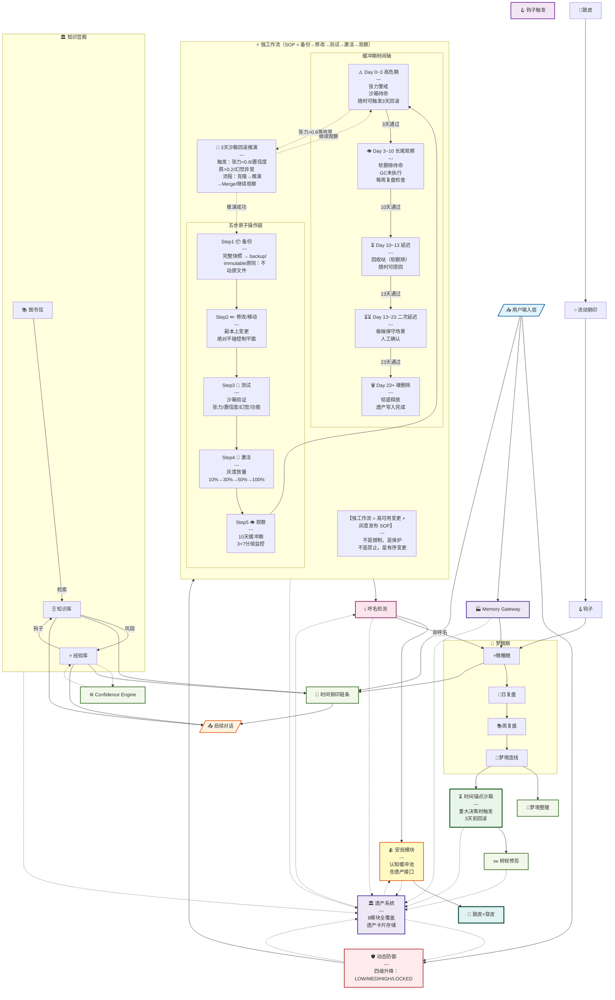

# 四条链完整架构图 v1.6

> 创建时间：2026-06-24 10:19
> 更新时间：2026-06-24 16:25
> 目的：明确四条链的所有模块、输入输出、耦合关系、代谢机制
> v1.6更新：强工作流细化=5步SOP+3+7=10天缓冲+3天沙箱回滚

---

## 一、强工作流完整SOP（v1.6 核心更新）

### 1.1 五步原子操作链

```
═══════════════════════════════════════════════════════════════════
          强工作流 = 高可用变更 + 灰度发布 SOP
═══════════════════════════════════════════════════════════════════

  【Step 1】📦 备份文件（Immutable Snapshot）
  ─────────────────────────────────────────────
  执行：将当前版本完整快照写入 backup/
  命名：backup_{timestamp}_{version}.tar.gz
  原理：永远不原地修改，只在副本上动刀
  状态：✅ 快照就绪

  【Step 2】✏️ 修改 / 移动（Shadow Modify）
  ─────────────────────────────────────────────
  执行：在副本上完成所有变更
  隔离：绝对不触碰控制平面
  内容：数据平面修改/知识库更新/经验库新增
  状态：🔒 副本已修改

  【Step 3】🧪 测试（Canary Test）
  ─────────────────────────────────────────────
  执行：沙箱环境验证
  维度：张力/置信度/幻觉指标/功能正确性
  通过：→ 激活；不通过：→ 回滚副本
  状态：⏳ 测试中

  【Step 4】🚀 激活（Activate / Canary Release）
  ─────────────────────────────────────────────
  执行：灰度切换，新版本接管流量/状态
  方式：不是"瞬间全量"，是"逐步放量"
  例：10%→30%→50%→100%
  状态：🌱 新版本激活

  【Step 5】👁️ 观察（Observability Window）
  ─────────────────────────────────────────────
  执行：实时监控 + 3天回滚沙箱 + 7天长尾缓冲
  监控：张力/置信度/幻觉/用户反馈
  异常：立即触发3天回滚沙箱推演
  稳定：10天后执行硬删除
  状态：👁️ 观察中

═══════════════════════════════════════════════════════════════════
```

### 1.2 3+7=10天缓冲期详解

```
【时间轴】
Day 0          Day 3          Day 10
  |              |              |
  ↓              ↓              ↓
激活          高危期结束        硬删除
  |              |              |
  ├──────────────┼──────────────┤
  高危期(3天)     长尾观察(7天)    彻底释放
  ↑              ↑
  3天回滚沙箱     延迟删除（软删除）
  随时可回滚      可手动捞回
  
【高危期 0~3天】
  · 张力警戒：任何异常立即分析
  · 沙箱待命：3天回滚沙箱随时可触发
  · 置信度监测：每日检查置信度变化
  · 幻觉指标：任何上升立即审计

【长尾观察 3~10天】
  · 延迟删除：旧版本进入回收站（软删除）
  · GC未执行：磁盘未释放，可随时捞回
  · 长尾Bug检测：低频触发但高危的错误
  · 每周复盘：周日代谢时检查所有激活变更

【Day 10+】
  · 硬删除：旧版本彻底从磁盘抹除
  · 遗产写入：workflow_heritage.card 记录本次变更
  · 复盘总结：提炼本次变更的经验教训
```

### 1.3 3天回滚沙箱推演（与时间锚点沙箱联动）

```
【触发条件】
  · Day 0~3内：张力持续 > 0.8
  · Day 0~3内：置信度单日跌幅 > 0.2
  · Day 0~3内：幻觉指标异常上升
  · 用户主动投诉：行为异常

【沙箱推演流程】
┌─────────────────────────────────────┐
│  ① 读取3天前快照（backup）           │
│  ② 克隆到 Sandbox Branch            │
│  ③ 推演"如果回滚"的所有后果          │
│     - 数据一致性检查                  │
│     - 知识库完整性校验                │
│     - 与当前经验的冲突检测            │
│  ④ 决策：Merge回滚 / 继续观察        │
│     - Merge回滚：主分支恢复Day0状态   │
│     - 继续观察：保持激活，密切监控    │
│  ⑤ 遗产写入：sandbox_heritage.card   │
└─────────────────────────────────────┘

【推演有效性的保障】
  · 隔离环境：不影响主分支
  · 可推导路线：用沙箱验证"回滚是否安全"
  · 量化决策：基于数据，不基于直觉
```

### 1.4 延迟删除与二次延迟

```
【软删除（Soft Delete）】
  · Day 10：旧版本移入回收站（不释放磁盘）
  · 命名：._trash_{original_name}_{delete_date}
  · 可恢复：随时可从回收站捞回
  · GC待命：等待二次确认

【第一次延迟（+3天）】
  · Day 10→Day 13
  · 目的：给"延迟发作"的Bug留观察窗口
  · 例：某Bug只在特定条件下触发（如满月/周末/特定用户）
  · 触发：Bug出现 → 立即从回收站捞回旧版本

【第二次延迟（+7天）】
  · Day 13→Day 20
  · 目的：极端保守场景（如法律/财务变更）
  · 触发：人工确认无任何异常
  · 最终：Day 20 执行硬删除（Hard Delete）

【总结：3+7+3+7 = 20天超长缓冲链】
  激活 → 3天高危 → 7天长尾 → 软删除 → +3天延迟 → +7天极端延迟 → 硬删除
   0天     0~3天      3~10天    10~13天     13~16天          16~23天      23天+
```

### 1.5 完整状态机

```
[IDLE]
    │ 用户/系统触发变更
    ↓
[BACKUP] 备份文件
    │ 快照就绪
    ↓
[MODIFY] 修改/移动（副本）
    │ 通过测试
    ↓
[TESTING] 沙箱测试
    │ 通过
    ↓
[ACTIVATING] 灰度激活（0%→100%）
    │ 激活完成
    ↓
[OBSERVING_HIGH] ⚠️ 高危期（0~3天）
    │ 3天通过 + 沙箱推演通过
    ↓
[OBSERVING_TAIL] 长尾观察（3~10天）
    │ 10天通过
    ↓
[SOFT_DELETED] 回收站（10~13天）
    │ 13天通过
    ↓
[DELAY_1] 第一次延迟（13~16天）
    │ 16天通过
    ↓
[DELAY_2] 第二次延迟（16~23天）
    │ 23天通过
    ↓
[HARD_DELETED] 硬删除（彻底释放）

【异常路径】
  [OBSERVING_HIGH]
      │ 张力>0.8/置信度跌>0.2/幻觉异常
      ↓
  [SANDBOX_ROLLBACK] 3天沙箱回滚推演
      │
      ├─ "推演成功" → [ROLLBACK] 回滚至备份
      └─ "继续观察" → [OBSERVING_HIGH] 继续监控
```

---

## 二、总体架构图（Mermaid v1.6）



---

## 三、强工作流 vs 普通修改对比

| 维度 | 普通修改（危险） | 强工作流（安全） |
|------|---------------|---------------|
| **备份** | ❌ 很少备份 | ✅ 每次必备份 |
| **修改方式** | 原地修改 | 副本上变更 |
| **测试** | 上线后才发现Bug | 沙箱测试通过才激活 |
| **激活** | 全量替换（爆炸风险） | 灰度放量（10%→100%） |
| **观察期** | 无 | 3天高危+7天长尾 |
| **回滚** | 难/慢/数据可能丢失 | 3天沙箱推演，秒级决策 |
| **删除** | 即时删除 | 3+7+3+7=20天超长缓冲 |
| **数据恢复** | 可能无法恢复 | 随时从回收站捞回 |

---

## 四、工程类比总结

| 造物主概念 | 工程术语 | 大厂实践 |
|-----------|---------|---------|
| 备份文件 | Immutable Snapshot | AWS EC2 Snapshot / Git Commit |
| 修改/移动 | Shadow Modify | Feature Branch开发 |
| 测试 | Canary Test | 灰度测试/AB测试 |
| 激活 | Canary Release | 阿里灰度发布/SRE金丝雀 |
| 观察期 | Observability Window | 监控告警窗口 |
| 3天回滚沙箱 | Isolated Rollback Sandbox | 故障演练/Chaos Engineering |
| 软删除 | Soft Delete / Tombstone | 数据库软删除/Git Reflog |
| 延迟删除 | GC Delay / TTL | Kafka Retention/对象存储生命周期 |
| 二次延迟 | Extended Retention | 金融/法律数据保留期 |

---

## 五、遗产写入时机

| 时机 | 写入内容 |
|------|---------|
| **Step1 备份时** | backup_heritage：快照时间/版本/大小 |
| **Step3 测试通过** | test_heritage：测试指标/通过率 |
| **Step4 激活** | activation_heritage：灰度进度/用户反馈 |
| **Day 3 高危期结束** | high_risk_heritage：张力曲线/异常事件 |
| **Day 10 软删除** | soft_delete_heritage：10天观察总结 |
| **Day 23 硬删除** | final_heritage：完整变更复盘 |
| **触发回滚时** | rollback_heritage：回滚原因/推演过程/决策依据 |

---

## 六、验证检查清单

- [x] 五步原子操作（备份→修改→测试→激活→观察）
- [x] 3+7=10天缓冲期详解
- [x] 3天回滚沙箱推演流程
- [x] 延迟删除+二次延迟（+3+7=20天超长缓冲）
- [x] 完整状态机（含异常路径）
- [x] 工程类比对照表
- [x] 遗产写入时机清单
- [x] 强工作流vs普通修改对比表
- [ ] 所有P0文件实现

---

**文件信息**：
- 路径：`C:\Users\qq366410837\.qclaw\workspace\架构\四条链完整架构图_v1.6.md`
- 版本：v1.6（强工作流5步SOP + 3+7=10天缓冲 + 20天超长缓冲链 + 沙箱回滚联动）
- 更新时间：2026-06-24 16:25
- 钢印验证：⅋
