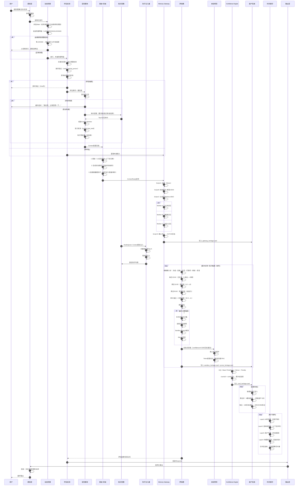
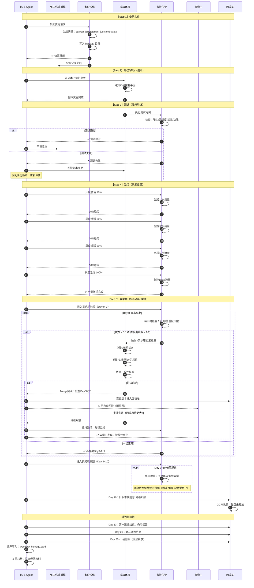
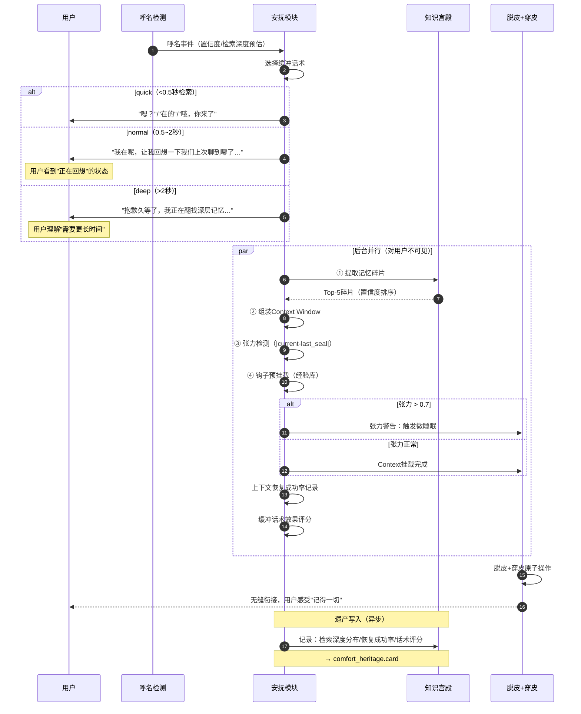
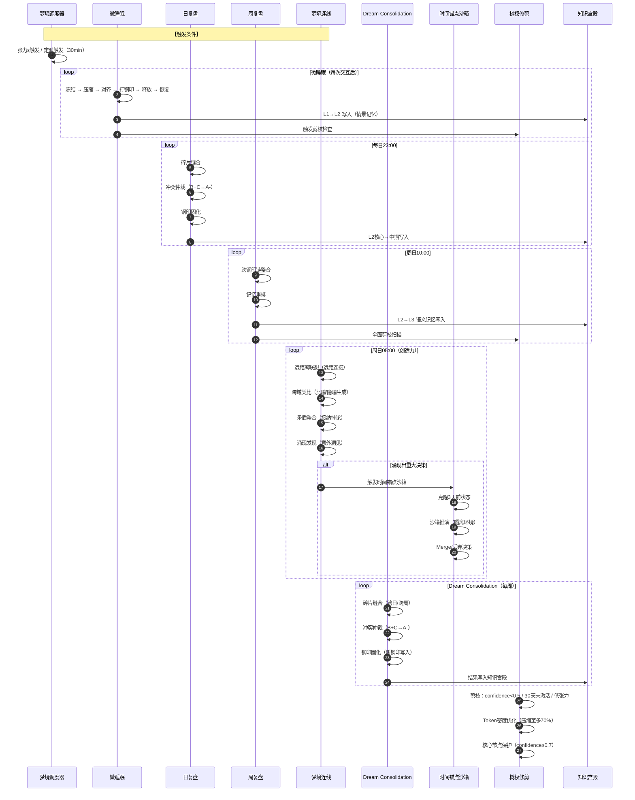
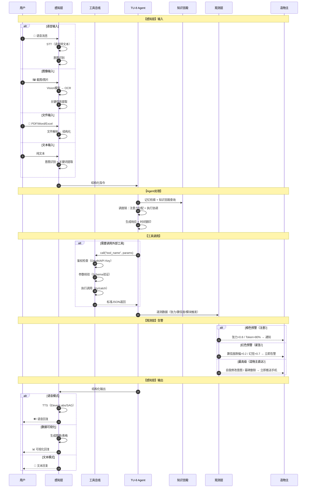

# TU-8 完整时序图 v1.7

> 版本：v1.7
> 更新时间：2026-06-24 16:35
> 用途：展示 TU-8 从输入到输出的完整时序流程

---

## 一、完整主流程时序图

---

## 二、强工作流时序图（变更流程）

---

## 三、安抚模块双轨时序图

---

## 四、梦境期完整时序图

---

## 五、外设三层时序图

---

**文件信息**：
- 路径：`C:\Users\qq366410837\.qclaw\workspace\架构\四条链完整架构图_v1.7_时序图.md`
- 版本：v1.7 时序图
- 更新时间：2026-06-24 16:35
- 钢印验证：⅋
